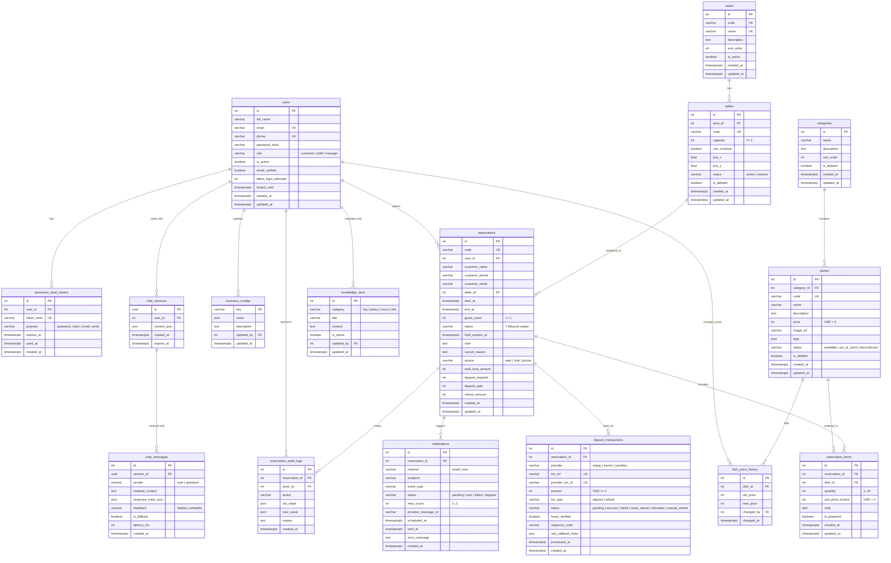

# THIẾT KẾ CƠ SỞ DỮ LIỆU & SƠ ĐỒ THỰC THỂ LIÊN KẾT (ERD)

**Dự án:** Website đặt bàn và đặt món trước cho nhà hàng tích hợp chatbot AI (`QL09-W`)  
**Đơn vị áp dụng:** Nhà hàng Ẩm thực Vườn Phố (TP.HCM · Tiền tệ `VNĐ` · Múi giờ `GMT+7`)  
**Hạng mục:** `[US-02]` ERD và migration CSDL (`MC-13` · WBS `1.3.3.1` · Hệ quản trị **PostgreSQL 16 + Alembic**)

---

## 1. Nguyên tắc thiết kế & Phân vùng Zero File-Overlap

1. **Tổng số bảng:** **16 bảng** chuẩn hóa 3NF (vượt yêu cầu tối thiểu `>= 8` bảng của `NFR-04`), chia làm 2 phân vùng sở hữu độc lập:
   - **Phân vùng Core (`Dev Fullstack` — `backend/app/models/core_models.py`):** **13 bảng** nghiệp vụ cốt lõi (`users`, `password_reset_tokens`, `categories`, `dishes`, `dish_price_history`, `areas`, `tables`, `reservations`, `reservation_items`, `deposit_transactions`, `reservation_audit_logs`, `notifications`, `business_configs`), khởi tạo tại migration nhánh `core` (`20261126_0001_core_initial_schema.py`).
   - **Phân vùng AI (`AI Dev` — `backend/app/models/ai_models.py`):** **3 bảng** trợ lý ảo (`knowledge_docs`, `chat_sessions`, `chat_messages`), triển khai độc lập trên nhánh migration `ai` (`*_ai_*`) mà không cần chỉnh sửa `core_models.py` hay `alembic/env.py`.
2. **Chuẩn thời gian & tiền tệ:**
   - Mọi cột thời điểm (`created_at`, `updated_at`, `start_at`, `end_at`, `hold_expires_at`...) sử dụng kiểu **`TIMESTAMPTZ`** (`DateTime(timezone=True)`), đồng bộ phiên kết nối PostgreSQL về `Asia/Ho_Chi_Minh` (`GMT+7`).
   - Mọi cột tiền tệ (`price`, `old_price`, `new_price`, `unit_price_locked`, `total_food_amount`, `deposit_required`, `deposit_paid`, `refund_amount`, `amount`) lưu **số nguyên `INTEGER` tính bằng `VNĐ`** (không dùng số thực dấu phẩy động tránh sai số làm tròn).
3. **Toàn vẹn tham chiếu & Xóa mềm (`Soft Delete`):**
   - Thực đơn (`categories`, `dishes`) và bàn (`tables`) chỉ xóa mềm qua cờ `is_deleted = true`.
   - Khóa ngoại từ `reservations.table_id -> tables.id` và `reservation_items.dish_id -> dishes.id` đặt **`ON DELETE RESTRICT`**, chặn tuyệt đối việc xóa vật lý bàn hoặc món đã phát sinh đơn đặt chỗ.
   - Giá món tại thời điểm khách chốt giỏ được khóa cứng vào `reservation_items.unit_price_locked`.

---

## 2. Sơ đồ ERD tổng thể (16 bảng: 13 Core + 3 AI)



---

## 3. Ràng buộc chống trùng bàn ở tầng PostgreSQL (`FR-05`)

Để đảm bảo **`0%` đơn trùng bàn** ngay cả khi nhiều khách gửi yêu cầu giữ cùng một bàn vào cùng một mili-giây (`Concurrent Booking`), hệ thống kết hợp **DB Transaction** và ràng buộc loại trừ **`EXCLUDE USING gist`** trên tiện ích `btree_gist` của PostgreSQL 16:

```sql
CREATE EXTENSION IF NOT EXISTS btree_gist;

ALTER TABLE reservations
ADD CONSTRAINT ex_reservations_no_overlapping_table_slot
EXCLUDE USING gist (
    table_id WITH =,
    tstzrange(start_at, end_at, '[)') WITH &&
)
WHERE (status IN ('pending_deposit', 'confirmed', 'checked_in'));
```

### Giải thích cơ chế hoạt động:
- **Khoảng nửa mở `[start_at, end_at)` (`'[)'`):** Đơn ca trước `17:30 – 19:00` và đơn kế tiếp `19:00 – 20:30` tiếp giáp tại đúng `19:00` được phép đặt nối tiếp hợp lệ mà không bị báo trùng.
- **Điều kiện lọc `WHERE (status IN ('pending_deposit', 'confirmed', 'checked_in'))`:**
  - Khi đơn đang giữ tạm `10 phút` (`pending_deposit`), đã cọc (`confirmed`) hoặc đang ngồi ăn (`checked_in`), mọi giao dịch chèn/đổi bàn chồng lấn khung giờ trên cùng `table_id` sẽ bị PostgreSQL từ chối tức thì bằng lỗi `ExclusionViolation` (`IntegrityError` → API trả `409 Conflict`).
  - Khi đơn chuyển sang trạng thái kết thúc giải phóng bàn (`expired`, `cancelled`, `no_show`, `completed`), khung giờ đó tự động mở lại cho khách khác đặt mà không cần xóa lịch sử đơn cũ.

---

## 4. Đặc tả ràng buộc toàn vẹn trên 13 bảng Core

| STT | Tên bảng | Khóa chính | Khóa ngoại & Quy tắc xóa | Ràng buộc nghiệp vụ (`UNIQUE` / `CHECK` / `EXCLUDE`) |
| :---: | :--- | :--- | :--- | :--- |
| 1 | `users` | `id` | — | `email` UNIQUE; `phone` UNIQUE; `role IN ('customer','staff','manager')`; `failed_login_attempts >= 0` |
| 2 | `password_reset_tokens` | `id` | `user_id -> users.id` (`CASCADE`) | `token_hash` UNIQUE; `purpose IN ('password_reset','email_verify')` |
| 3 | `categories` | `id` | — | `is_deleted` xóa mềm |
| 4 | `dishes` | `id` | `category_id -> categories.id` (`RESTRICT`) | `code` UNIQUE; `price > 0`; `status IN ('available','out_of_stock','discontinued')` |
| 5 | `dish_price_history` | `id` | `dish_id -> dishes.id` (`RESTRICT`), `changed_by -> users.id` (`SET NULL`) | `old_price > 0`; `new_price > 0` |
| 6 | `areas` | `id` | — | `code` UNIQUE; `name` UNIQUE |
| 7 | `tables` | `id` | `area_id -> areas.id` (`RESTRICT`) | `code` UNIQUE; `capacity >= 1`; `status IN ('active','inactive')`; tọa độ `pos_x`, `pos_y` |
| 8 | `reservations` | `id` | `table_id -> tables.id` (`RESTRICT`), `user_id -> users.id` (`RESTRICT`) | `code` UNIQUE; `end_at > start_at`; `guest_count >= 1`; 7 trạng thái; `source IN ('web','chat','phone')`; **`ex_reservations_no_overlapping_table_slot`** |
| 9 | `reservation_items` | `id` | `reservation_id -> reservations.id` (`CASCADE`), `dish_id -> dishes.id` (`RESTRICT`) | `quantity BETWEEN 1 AND 20`; `unit_price_locked > 0` |
| 10 | `deposit_transactions` | `id` | `reservation_id -> reservations.id` (`RESTRICT`) | `txn_ref` UNIQUE; `provider_txn_id` UNIQUE (chống xử lý trùng webhook); `amount >= 0`; không lưu thông tin thẻ |
| 11 | `reservation_audit_logs` | `id` | `reservation_id -> reservations.id` (`CASCADE`), `actor_id -> users.id` (`SET NULL`) | Lưu vết `action`, `old_value`, `new_value`, `reason` |
| 12 | `notifications` | `id` | `reservation_id -> reservations.id` (`CASCADE`) | `channel IN ('email','sms')`; `retry_count BETWEEN 0 AND 3` |
| 13 | `business_configs` | `key` | `updated_by -> users.id` (`SET NULL`) | Lưu JSON tham số động (`US-20`), chỉ áp dụng cho đơn tạo mới |

---

## 5. Hướng dẫn vận hành Alembic Migration

Chạy các lệnh sau từ thư mục `backend/`:

```powershell
# 1. Nâng cấp CSDL trống lên phiên bản mới nhất của tất cả nhánh (Core + AI)
.\.venv\Scripts\python.exe -m alembic upgrade heads

# 2. Kiểm tra phiên bản migration hiện hành
.\.venv\Scripts\python.exe -m alembic current

# 3. Xuất SQL chuẩn PostgreSQL để kiểm tra câu lệnh DDL (không cần mở kết nối DB)
.\.venv\Scripts\python.exe -m alembic upgrade heads --sql

# 4. Tạo migration mới thuộc phân vùng Core (Dev Fullstack)
.\.venv\Scripts\python.exe -m alembic revision --autogenerate -m "core_ten_thay_doi" --head core@head

# 5. Tạo migration thuộc phân vùng AI (dành cho AI Dev — không đụng core_models.py)
.\.venv\Scripts\python.exe -m alembic revision --autogenerate -m "ai_initial_tables" --branch-label ai --head 20261126_0001_core
```
