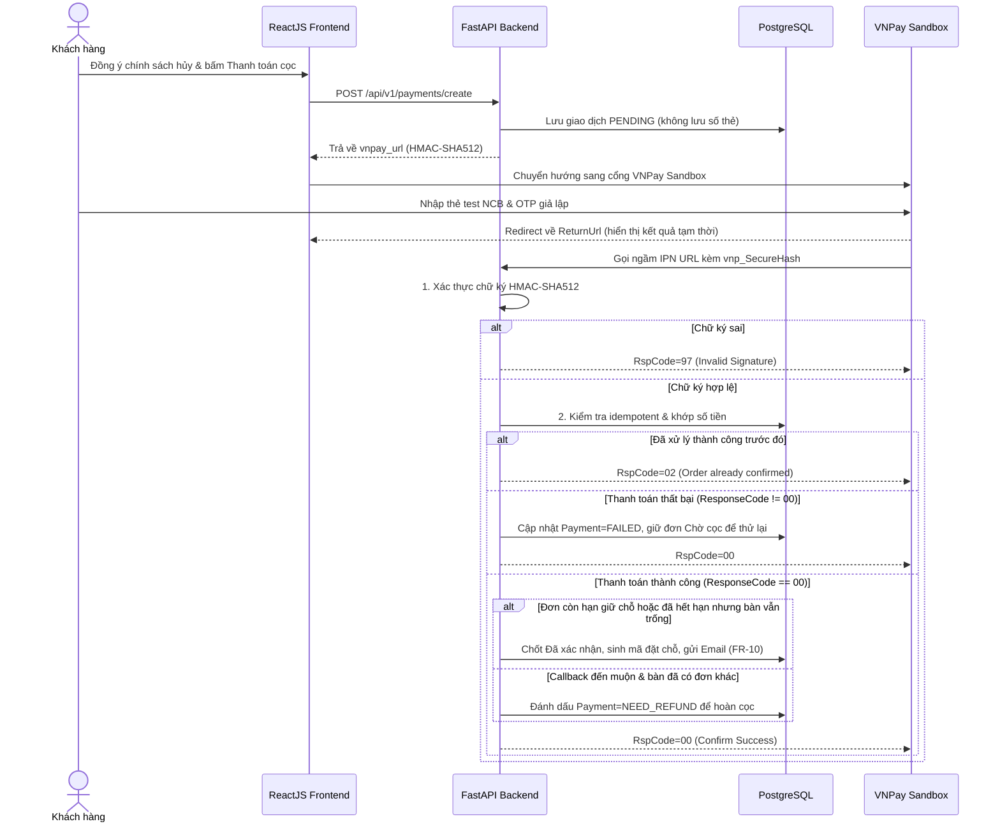

# BÁO CÁO KHẢO SÁT CỔNG THANH TOÁN SANDBOX & DỊCH VỤ EMAIL/SMS

**Học phần:** Quản lý dự án Công nghệ thông tin • **Mã đề tài:** QL09-W • **Task Jira:** [MC-69](https://tranhoangphuc98765432.atlassian.net/browse/MC-69) • **Mã WBS:** `1.1.3.3`

| Thông tin tài liệu | Nội dung chi tiết |
| --- | --- |
| Tên dự án | Website đặt bàn và đặt món trước cho nhà hàng tích hợp chatbot AI (`QL09-W`) |
| Đơn vị áp dụng | Nhà hàng Ẩm thực Vườn Phố (1 cơ sở tại TP. Hồ Chí Minh, tiền tệ VNĐ, múi giờ GMT+7) |
| Công việc tương ứng | `[FS] Khảo sát cổng thanh toán Sandbox (VNPay/MoMo/PayOS) & Email/SMS` — WBS `1.1.3.3` (6 giờ công, Sprint 0) |
| Phạm vi thực hiện | `[Nghiên cứu] Không sửa code` — Cung cấp bảng so sánh và phương án đề xuất cho PM chốt đầu Sprint 1 (`MC-70`) |
| Người lập | Nguyễn Văn Tiến (`Dev Fullstack`) |
| Người phê duyệt | Trần Hoàng Phúc (`PM/SM`) • Phối hợp rà soát: Võ Đăng Khoa (`PO/BA`) |
| Ngày lập & Trạng thái | 25/11/2026 — **Đã phê duyệt chốt phương án tại `MC-70` (26/11/2026)** |

---

## 1. Mục tiêu và Ràng buộc khảo sát

Tài liệu này tổng hợp kết quả khảo sát kỹ thuật và chi phí cho hai nhóm dịch vụ bên thứ ba của hệ thống: **(1) Cổng thanh toán trực tuyến môi trường thử nghiệm (Sandbox)** và **(2) Dịch vụ gửi thông báo Email & SMS**, nhằm bảo đảm đáp ứng đúng yêu cầu nghiệp vụ trong SRS v1.1, Scope Statement (`D02`) và giới hạn ngân sách của Project Charter (`D01`):

1. **Ràng buộc phạm vi (`Scope §2.4`):** Không phát sinh giao dịch thanh toán bằng tiền thật; toàn bộ quá trình phát triển, kiểm thử và nghiệm thu UAT sử dụng **môi trường Sandbox miễn phí (`0 VNĐ`)**.
2. **Ràng buộc ngân sách (`Project Charter §1`):** Trong tổng chi phí dịch vụ & hạ tầng `1.625.000 VNĐ`, phần **Cổng thanh toán Sandbox = `0 VNĐ`** và phần **Email SMTP & SMS nhắc lịch = tối đa `200.000 VNĐ`**.
3. **Yêu cầu thanh toán (`FR-07`, `US-24`, `US-25`, `NFR-02`):**
   - Không lưu số thẻ hay thông tin thanh toán nhạy cảm trên hệ thống nhà hàng.
   - Bắt buộc xác thực chữ ký điện tử **HMAC** trên Callback/Webhook trước khi cập nhật trạng thái đơn.
   - Xử lý **idempotent** (gọi trùng Callback/Webhook nhiều lần không ghi nhận cọc 2 lần).
   - Xử lý callback thành công đến muộn sau khi hết hạn giữ chỗ 10 phút: nếu bàn còn trống thì xác nhận đơn; nếu bàn đã bị đặt thì đánh dấu hoàn cọc và thông báo khách.
   - Thanh toán thất bại: giữ đơn ở trạng thái `Chờ cọc` trong thời gian giữ chỗ để khách thử lại.
4. **Yêu cầu hoàn cọc (`FR-09`, `US-26`, `US-48` dự phòng):** Hỗ trợ ghi nhận yêu cầu hoàn cọc ở MVP và sẵn sàng mở rộng gọi API hoàn cọc tự động (`refund`) nếu kích hoạt `US-48`.
5. **Yêu cầu thông báo & nhắc lịch (`FR-10`, `US-04`, `US-06`, `US-27`, `US-38`):**
   - **Email:** Gửi email xác thực đăng ký, đặt lại mật khẩu (dùng 1 lần), xác nhận cọc thành công, hủy đơn và nhắc lịch tự động trước **24 giờ** và **2 giờ**.
   - **SMS:** Chỉ dùng cho sự kiện quan trọng (**nhắc lịch trước 2 giờ**) khi được bật (`SMS_ENABLED`), nhằm kiểm soát chi phí trong hạn mức `200.000 VNĐ`.
   - Khi gửi lỗi: tự động **retry tối đa 3 lần** và ghi trạng thái gửi; nếu SĐT không hợp lệ thì tự động **fallback sang Email**.
6. **Kiến trúc kỹ thuật:** Tích hợp sạch trên **Python FastAPI** + **PostgreSQL** + **Docker** (môi trường Local, Staging và Production).

---

## 2. Khảo sát & So sánh Cổng thanh toán Sandbox (VNPay vs. MoMo vs. PayOS)

### 2.1 Phân tích chi tiết từng cổng thanh toán

#### A. VNPay Sandbox (`sandbox.vnpayment.vn`)
- **Cơ chế hoạt động:** Chuyển hướng người dùng sang trang thanh toán Web của VNPay qua URL có ký tham số (`vnp_SecureHash`), sau đó trả kết quả qua 2 kênh độc lập:
  - **Return URL (`GET`):** Điều hướng trình duyệt khách hàng về trang kết quả trên Frontend/Backend để hiển thị giao diện.
  - **IPN URL (`GET`):** Server VNPay gọi ngầm server-to-server về Backend để chốt trạng thái đơn; Backend trả JSON chuẩn `{"RspCode": "00", "Message": "Confirm Success"}` (hoặc `97` sai chữ ký, `01` không thấy đơn, `02` đơn đã xác nhận trước đó, `04` sai số tiền).
- **Đăng ký & Cấu hình Sandbox:** Đăng ký nhanh tài khoản developer tại `https://sandbox.vnpayment.vn/devreg/` để nhận bộ `vnp_TmnCode`, `vnp_HashSecret` và endpoint `https://sandbox.vnpayment.vn/paymentv2/vpcpay.html` (hoàn toàn miễn phí, không cần GPKD hay tiền thật).
- **Bảo mật:** Sắp xếp tham số theo thứ tự alphabet (`sorted`), tạo chữ ký **HMAC-SHA512** bằng `vnp_HashSecret`.
- **Trải nghiệm kiểm thử & Demo:**
  - Cung cấp sẵn thẻ ATM nội địa test của ngân hàng NCB (số thẻ `9704198526191432193`, tên `NGUYEN VAN A`, ngày phát hành `07/15`, OTP giả lập `123456`) và các mã lỗi giả lập để test cả trường hợp thành công, hủy thanh toán, sai số tiền, callback trùng lặp.
  - Có API Sandbox `querydr` (truy vấn trạng thái giao dịch) và `refund` (hoàn tiền) giúp đáp ứng dễ dàng cả `US-48` nếu triển khai.
- **Lưu ý kỹ thuật khi cài đặt trên FastAPI:**
  - `vnp_Amount` phải nhân `100` (ví dụ cọc `300.000 VNĐ` truyền `"30000000"`).
  - Cần đồng bộ múi giờ `GMT+7` cho `vnp_CreateDate` / `vnp_ExpireDate` (`YYYYMMDDHHMMSS`).
  - Khi chạy ở `localhost`, cần mở public tunnel (Ngrok / Cloudflare Tunnel) hoặc triển khai lên Staging có HTTPS để VNPay gọi được `IPN URL`.

#### B. MoMo Sandbox (`test-payment.momo.vn`)
- **Cơ chế hoạt động:** Backend gọi API `POST https://test-payment.momo.vn/v2/gateway/api/create` kèm chữ ký `signature`, nhận về `payUrl` / `shortLink` rồi chuyển hướng khách hàng. MoMo trả kết quả qua:
  - **Redirect URL (`GET`):** Chuyển trình duyệt khách về website.
  - **IPN URL (`POST` JSON):** Server MoMo đẩy webhook JSON chứa `resultCode`, `transId`, `amount`, `signature`; Backend xác thực và trả HTTP `204 No Content` (hoặc `200 OK`).
- **Đăng ký & Cấu hình Sandbox:** Lấy thông tin `partnerCode`, `accessKey`, `secretKey` qua cổng developer / MoMo Business Sandbox (`https://business.momo.vn/`).
- **Bảo mật:** Tạo chuỗi `rawSignature` theo đúng thứ tự trường quy định của MoMo v2 và ký bằng **HMAC-SHA256** với `secretKey`.
- **Trải nghiệm kiểm thử & Demo:**
  - Có API test `query` và `refund` trên môi trường `test-payment.momo.vn`.
  - **Điểm hạn chế khi demo nhanh:** Luồng `captureWallet` (quét QR ví MoMo) yêu cầu cài đặt **MoMo Test App** riêng trên điện thoại hoặc dùng luồng thanh toán thẻ ATM/Visa giả lập (`payWithATM` / `payWithCC`) trên web, kém trực quan hơn nếu giảng viên/nhà hàng kiểm thử ngay trên trình duyệt desktop.

#### C. PayOS – VietQR A2A (`api-merchant.payos.vn`)
- **Cơ chế hoạt động:** Tạo link thanh toán / mã VietQR động (`orderCode`, `amount`) qua API REST; khi khách chuyển khoản ngân hàng thành công, PayOS bắn **Webhook (`POST` JSON)** về server kèm chữ ký `signature`.
- **Bảo mật:** Ký và xác thực bằng **HMAC-SHA256** dùng `Checksum Key` (kèm `Client ID`, `API Key`) và có SDK Python chính thức (`payos`).
- **Điểm nghẽn lớn với đồ án `QL09-W`:**
  - **PayOS KHÔNG có môi trường Sandbox tách biệt hoàn toàn:** Mọi giao dịch chạy trực tiếp trên hạ tầng API chính thức (`https://api-merchant.payos.vn`), yêu cầu xác thực định danh cá nhân (CCCD) trên `my.payos.vn` và liên kết tài khoản ngân hàng thật.
  - Để test E2E và kích hoạt Webhook, bắt buộc phải **chuyển tiền thật** (khuyến nghị `2.000 – 10.000 VNĐ`/lần qua app ngân hàng).
  - Không thể tự động giả lập các kịch bản thất bại cổng, callback đến muộn sau 10 phút, hay gọi API hoàn cọc tự động (`refund` không hỗ trợ qua cổng VietQR A2A thuần như ví/cổng truyền thống) mà không tốn tiền thật.
- **Chi phí vận hành thực tế (tham khảo cho nhà hàng khi Go-live thương mại):** Phí cài đặt & duy trì `0 VNĐ`, hỗ trợ các gói miễn phí số lượng giao dịch theo từng ngân hàng liên kết, tiết kiệm phí trung gian cho mô hình chuyển khoản VietQR.

---

### 2.2 Bảng so sánh tổng hợp Cổng thanh toán

| Tiêu chí so sánh | VNPay Sandbox | MoMo Sandbox | PayOS (VietQR A2A) |
| --- | --- | --- | --- |
| **Môi trường Sandbox riêng** | Có (`sandbox.vnpayment.vn`) | Có (`test-payment.momo.vn`) | **Không** (test trực tiếp trên API thật) |
| **Cần tiền thật / Tài khoản NH thật** | Không (dùng thẻ test NCB) | Không (dùng thẻ test / MoMo Test App) | **Có** (cần CCCD + chuyển 2k–10k VNĐ thật) |
| **Thuật toán ký & xác thực** | `HMAC-SHA512` (`vnp_HashSecret`) | `HMAC-SHA256` (`secretKey`) | `HMAC-SHA256` (`Checksum Key`) |
| **Cơ chế Return & Callback/IPN** | `ReturnUrl` (`GET`) + `IPN URL` (`GET` trả `RspCode`) | `redirectUrl` (`GET`) + `ipnUrl` (`POST` trả HTTP 204) | `returnUrl`/`cancelUrl` + Webhook (`POST` trả HTTP 200) |
| **Test kịch bản lỗi / trễ / trùng IPN** | Rất dễ (mã thẻ/OTP test & gọi lại IPN URL) | Tốt (hỗ trợ test `resultCode` & IPN) | Khó (phải chuyển tiền thật; khó ép lỗi cổng) |
| **API Hoàn cọc (`refund`) Sandbox** | Có (`/merchant_webapi/api/transaction`) | Có (`/v2/gateway/api/refund`) | Không hỗ trợ refund tự động qua VietQR A2A |
| **Tích hợp trên Python FastAPI** | Thuần `hmac` + `hashlib` + `urllib.parse` (không phụ thuộc SDK nặng) | Thuần `hmac` + `hashlib` + `httpx` | Có package `payos` hoặc `hmac` + `httpx` |
| **Độ thuận tiện khi Demo & UAT** | Rất cao (demo ngay trên trình duyệt bằng thẻ NCB) | Trung bình–Khá (tiện nhất nếu dùng `payWithATM`; ví cần app test) | Thấp cho đồ án (mỗi lượt demo tốn tiền thật trên app NH) |
| **Chi phí trong phạm vi đồ án** | **0 VNĐ** | **0 VNĐ** | **0 VNĐ phí cổng** (nhưng phát sinh chuyển khoản thật khi test) |
| **Phí thương mại thực tế (tham khảo)** | ~1,1% – 2,2%+ (tùy phương thức thẻ/QR) | ~1% – 2%+ (tùy phương thức) | `0 VNĐ` duy trì, có các gói miễn phí giao dịch theo NH |
| **Mức độ phù hợp với `QL09-W`** | **Rất phù hợp (Đề xuất Chính)** | **Phù hợp (Đề xuất Dự phòng)** | **Không phù hợp cho giai đoạn Sandbox đồ án** |

---

### 2.3 Đề xuất lựa chọn & Kiến trúc tích hợp thanh toán

- **Cổng thanh toán Chính (Ưu tiên #1): `VNPay Sandbox`**
  - Đáp ứng 100% ràng buộc của `Scope §2.4` (không dùng tiền thật), `FR-07` (`US-24`, `US-25`), `NFR-02` (HMAC-SHA512, không lưu số thẻ) và hỗ trợ sẵn API `refund` Sandbox nếu nhóm kéo `US-48` (hoàn cọc tự động) từ Backlog dự phòng.
  - Dễ dàng chạy kịch bản demo và UAT trực tiếp trên điện thoại lẫn máy tính của Nhà hàng Ẩm thực Vườn Phố bằng thẻ NCB giả lập.
- **Cổng thanh toán Dự phòng (#2): `MoMo Sandbox`**
  - Chỉ kích hoạt bổ sung nếu môi trường `sandbox.vnpayment.vn` gặp sự cố gián đoạn kéo dài trong Sprint 4–7.
- **Định hướng thiết kế code cho Sprint 4 (`PaymentGatewayBase`):**
  - Thiết kế lớp trừu tượng `PaymentGatewayBase` (Strategy Pattern) tại `backend/app/services/payment/` gồm 3 phương thức chuẩn: `create_payment_url()`, `verify_callback()`, `refund_transaction()`.
  - Nhờ tách interface, toàn bộ `Reservation` và `PaymentTransaction` trong PostgreSQL độc lập với nhà cung cấp — sau này Nhà hàng Ẩm thực Vườn Phố muốn chuyển sang **PayOS VietQR** khi vận hành thương mại chỉ cần thêm 1 adapter mới mà không sửa luồng nghiệp vụ.

#### Luồng xử lý Callback/IPN an toàn (đáp ứng 4 kịch bản `US-25`)



---

## 3. Khảo sát & So sánh Dịch vụ Email (SMTP / REST API)

### 3.1 Bảng so sánh các phương án gửi Email

| Tiêu chí so sánh | Brevo (SMTP & API) | Resend (REST API & SMTP) | Gmail SMTP (`smtp.gmail.com`) | Mailpit / MailHog (Local Docker) |
| --- | --- | --- | --- | --- |
| **Gói miễn phí (Free Tier)** | **300 email/ngày** vĩnh viễn (~9.000/tháng) | **3.000 email/tháng** (giới hạn 100 email/ngày) | Miễn phí (~500 email/ngày với tài khoản cá nhân) | Không giới hạn (chỉ chạy nội bộ local) |
| **Yêu cầu thẻ tín dụng** | Không | Không | Không | Không |
| **Yêu cầu tên miền riêng** | Không bắt buộc khi test (có thể dùng sender email xác thực) | Không bắt buộc với địa chỉ test (`onboarding@resend.dev`), nhưng gửi cho người lạ cần verify domain | Không | Không |
| **Giao thức hỗ trợ** | SMTP Relay (`smtp-relay.brevo.com:587`) + REST API | REST API (`api.resend.com`) + SMTP | SMTP (`587` TLS) qua App Password | SMTP (`1025`) + Web UI (`8025`) |
| **Theo dõi trạng thái & Retry** | Có Message ID, Log giao dịch chi tiết, Webhook | Có Message ID, Logs trực quan, Webhook | Không có API log/webhook; dễ bị chặn spam khi gửi tự động | Xem ngay trên Web UI (không gửi thật ra internet) |
| **Nguy cơ bị khóa khi demo/UAT** | Thấp | Thấp | **Cao** (Google thường chặn đăng nhập từ IP VPS mới / gắn cờ spam) | Không áp dụng |
| **Chi phí cho dự án `QL09-W`** | **0 VNĐ** | **0 VNĐ** | **0 VNĐ** | **0 VNĐ** |
| **Đề xuất vai trò** | **Chính (Staging & Production)** | **Dự phòng #1 (Staging & Production)** | Chỉ dùng thử nghiệm khẩn cấp | **Chính (Local Dev & CI)** |

### 3.2 Phương án Email đề xuất

1. **Môi trường Local Dev & CI:** Dùng container **Mailpit** tích hợp sẵn trong `docker-compose.yml` — bắt 100% email đăng ký, quên mật khẩu, xác nhận đặt bàn và nhắc lịch 24h/2h trên Web UI nội bộ (`localhost:8025`), không làm phiền hộp thư thật khi chạy test tự động (`US-39`).
2. **Môi trường Staging & Production:** Dùng **Brevo** (`Free Plan — 300 email/ngày`, `0 VNĐ`, không cần thẻ tín dụng):
   - Hỗ trợ gửi ngay qua **SMTP Relay** (hoặc HTTP REST API `POST https://api.brevo.com/v3/smtp/email` tránh tình trạng một số nhà cung cấp Cloud/VPS chặn cổng SMTP `25/587`).
   - Dư sức đáp ứng lưu lượng 30–50 lượt đặt bàn/ngày của Nhà hàng Ẩm thực Vườn Phố (ước tính tối đa ~120–180 email/ngày gồm xác nhận + nhắc lịch 24h + nhắc lịch 2h).
   - Trả về `messageId` rõ ràng để Backend lưu trạng thái gửi vào bảng thông báo và thực hiện **retry tối đa 3 lần** khi gặp lỗi mạng (`US-27`, `US-38`).
3. **Dự phòng Email:** **Resend** (khi nhóm đã cấu hình tên miền riêng của dự án `300.000 VNĐ` ở Sprint 4, có thể verify DNS cho cả Brevo hoặc Resend để tăng tỷ lệ vào Inbox).

---

## 4. Khảo sát & So sánh Dịch vụ SMS (Nhắc lịch trước 2 giờ – `FR-10`)

### 4.1 Bảng so sánh các nhà cung cấp SMS

| Tiêu chí so sánh | SpeedSMS.vn | eSMS.vn | Twilio (Quốc tế) | Mock / Log SMS Provider |
| --- | --- | --- | --- | --- |
| **Phạm vi mạng VN** | Trực tiếp Viettel, MobiFone, VinaPhone, Vietnamobile, Gmobile | Trực tiếp các nhà mạng Việt Nam (hỗ trợ cả Zalo ZNS) | Định tuyến quốc tế về Việt Nam | Giả lập nội bộ |
| **Đơn giá tham khảo / SMS** | ~**590 VNĐ/SMS** (CSKH Viettel/Mobi/Vina); ~790 VNĐ/SMS (QC) | Mức giá cạnh tranh nội địa theo gói nạp trả trước | Rất cao: từ ~**$0.28+ USD/SMS** (~7.000+ VNĐ/tin) | **0 VNĐ** |
| **Tài khoản dùng thử / Sandbox** | Có tài khoản thử nghiệm & API key khi đăng ký | Có credit dùng thử khi đăng ký tài khoản dev | Có Trial Credit (nhưng bị giới hạn số đã verify) | Không giới hạn |
| **Vấn đề Brandname (Nghị định 91)** | Brandname tốn ~200k khởi tạo + ~200k/tháng (cần GPKD); đầu số ngẫu nhiên/CSKH test không tốn phí duy trì Brandname | Tương tự: Brandname yêu cầu hồ sơ doanh nghiệp & phí duy trì | Sender ID chưa đăng ký tại VN dễ bị nhà mạng chặn | Không yêu cầu |
| **Tích hợp Python FastAPI** | REST API đơn giản (`api.speedsms.vn`), hỗ trợ Basic Auth/Token | REST API (`rest.esms.vn`), tài liệu tiếng Việt đầy đủ | SDK `twilio` chính thức | In log + lưu DB |
| **Phù hợp ngân sách `200.000 VNĐ`** | **Rất phù hợp** (nạp 100k–200k gửi được ~170–330 tin) | **Rất phù hợp** (nạp trả trước theo gói ≤ 200k) | **Không phù hợp** (chỉ gửi được ~25 tin với 200k) | Phù hợp cho Dev/CI |

### 4.2 Phương án SMS đề xuất (Kiểm soát chi phí trong `200.000 VNĐ`)

1. **Nhà cung cấp đề xuất:** **SpeedSMS.vn** (hoặc **eSMS.vn** làm phương án thay thế tương đương).
   - Sử dụng tài khoản thử nghiệm / gói nạp trả trước tối đa **`200.000 VNĐ`** bằng đầu số mặc định/CSKH test trong giai đoạn Staging & UAT (không đăng ký SMS Brandname riêng trong đồ án vì phí khởi tạo + duy trì Brandname ~400.000 VNĐ vượt ngân sách và đòi hỏi giấy phép đăng ký kinh doanh).
   - Nếu Nhà hàng Ẩm thực Vườn Phố vận hành lâu dài sau nghiệm thu, nhà hàng có thể cung cấp GPKD để đăng ký Brandname `VUONPHO` hoặc kết nối thêm Zalo ZNS qua eSMS.
2. **Cơ chế an toàn & tiết kiệm chi phí trên Backend (`US-38`):**
   - Áp dụng **Feature Flag `SMS_ENABLED=false|true`**: mặc định tắt (`MockSMSProvider`) trên Local/CI để tránh tốn phí ngoài ý muốn; chỉ bật `SMS_ENABLED=true` khi demo hoặc chạy UAT.
   - Chỉ kích hoạt SMS cho **mốc nhắc lịch quan trọng trước 2 giờ** (mốc 24 giờ chỉ gửi Email, đúng theo `SRS §1.7` và `FR-10`).
   - Chuẩn hóa SĐT Việt Nam (`0x` / `+84`); nếu SĐT không hợp lệ hoặc dịch vụ SMS lỗi quá **3 lần retry**, tự động **fallback sang Email** và ghi rõ trạng thái vào nhật ký đơn.

---

## 5. Tổng hợp Phương án Đề xuất & Đối soát Ngân sách (`D01`)

### 5.1 Bảng chốt phương án & Dự toán chi phí

| Hạng mục | Phương án Chính đề xuất | Phương án Dự phòng | Chi phí dự toán (Đồ án) | Ghi chú triển khai |
| --- | --- | --- | --- | --- |
| **Cổng thanh toán (`FR-07`, `FR-09`)** | **VNPay Sandbox** | MoMo Sandbox | **0 VNĐ** | Thẻ test NCB, HMAC-SHA512, IPN URL + ReturnUrl, hỗ trợ API refund sandbox |
| **Dịch vụ Email (`FR-01`, `FR-10`)** | **Brevo** (Staging/Prod) + **Mailpit** (Local) | Resend (Free 3.000/tháng) | **0 VNĐ** | Brevo Free 300 email/ngày, dùng REST API/SMTP Relay kèm retry 3 lần |
| **Dịch vụ SMS (`FR-10` mốc 2h)** | **SpeedSMS.vn** (hoặc **eSMS.vn**) | MockSMSProvider + Email Fallback | **≤ 200.000 VNĐ** | Đầu số test/trả trước (không mở Brandname), cờ `SMS_ENABLED` kiểm soát chi phí |
| **Tổng chi phí Payment + Email/SMS** | — | — | **≤ 200.000 VNĐ** | **Khớp 100% dự toán `Project Charter` (`0 + 200.000 VNĐ`)** |

### 5.2 Biến môi trường dự kiến (`.env.example` cho Sprint 1 & Sprint 4)

```env
# --- Payment Gateway (VNPay Sandbox) ---
PAYMENT_PROVIDER=vnpay
VNPAY_TMN_CODE=
VNPAY_HASH_SECRET=
VNPAY_PAYMENT_URL=https://sandbox.vnpayment.vn/paymentv2/vpcpay.html
VNPAY_API_URL=https://sandbox.vnpayment.vn/merchant_webapi/api/transaction
VNPAY_RETURN_URL=https://staging.domain.vn/payment/vnpay-return
VNPAY_IPN_URL=https://api-staging.domain.vn/api/v1/payments/vnpay/ipn

# --- Email Notification (Mailpit Local / Brevo Staging & Prod) ---
EMAIL_PROVIDER=brevo        # mailpit | brevo | smtp
BREVO_API_KEY=
SMTP_HOST=smtp-relay.brevo.com
SMTP_PORT=587
SMTP_USER=
SMTP_PASSWORD=
EMAIL_FROM_NAME=Nha hang Am thuc Vuon Pho
EMAIL_FROM_ADDRESS=no-reply@domain.vn

# --- SMS Notification (Mock Local / SpeedSMS Staging & Prod) ---
SMS_ENABLED=false           # true khi demo/UAT mốc nhắc lịch 2h
SMS_PROVIDER=mock           # mock | speedsms | esms
SMS_API_KEY=
SMS_SENDER=
```

### 5.3 Checklist hành động đầu Sprint 1 (cho PM/SM `MC-70` & Dev Fullstack)

- [x] **PM/SM (`MC-70`):** Ký chốt lựa chọn **VNPay Sandbox** (chính) + **MoMo Sandbox** (dự phòng), **Brevo + Mailpit** (Email), và **SpeedSMS/eSMS gói ≤ 200k** (SMS) ngay đầu Sprint 1 *(đã phê duyệt ngày 26/11/2026)*.
- [ ] **Dev Fullstack:** Đăng ký tài khoản **VNPay Sandbox** tại `https://sandbox.vnpayment.vn/devreg/` và lưu `TMN_CODE` + `HASH_SECRET` vào kênh bảo mật nhóm (không commit lên GitHub).
- [ ] **Dev Fullstack:** Đăng ký tài khoản **Brevo Free** và tài khoản thử nghiệm **SpeedSMS / eSMS** trước Sprint 4 (`WBS 1.9.3.3`).
- [ ] **Dev Fullstack + PM/SM:** Đảm bảo URL Staging có HTTPS (Sprint 4) để VNPay Sandbox gọi được `VNPAY_IPN_URL` công khai (dùng Ngrok/Cloudflare Tunnel khi kiểm thử ở Local).

---

## 6. Phê duyệt Chốt Phương án (Đầu Sprint 1)

| Vai trò | Họ và tên | Quyết định | Ngày chốt |
| :--- | :--- | :--- | :---: |
| Người khảo sát – Lập trình viên Fullstack (`Dev Fullstack`) | Nguyễn Văn Tiến | Đề xuất phương án | `25/11/2026` |
| Chủ sản phẩm / Phân tích nghiệp vụ (`PO/BA`) | Võ Đăng Khoa | Đồng thuận nghiệp vụ `FR-07`, `FR-09`, `FR-10` | `26/11/2026` |
| Quản lý dự án / Scrum Master (`PM/SM`) | Trần Hoàng Phúc | **Đã phê duyệt** chốt **VNPay Sandbox** (chính) + **MoMo Sandbox** (dự phòng), **Brevo + Mailpit** (Email), **SpeedSMS/eSMS gói <= 200.000 VNĐ** (`SMS_ENABLED`) tại **`MC-70`** | `26/11/2026` |
