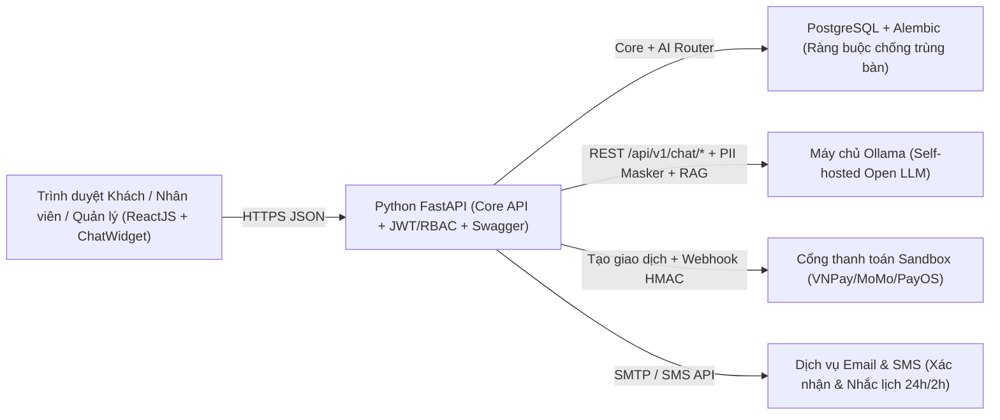
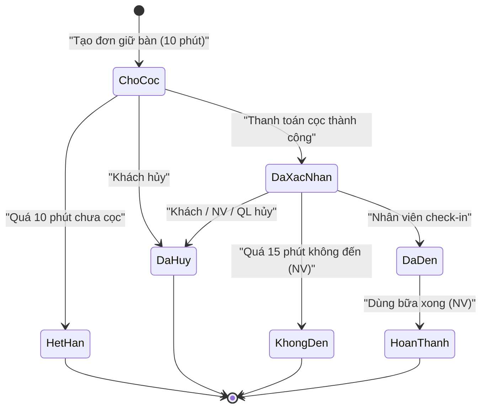
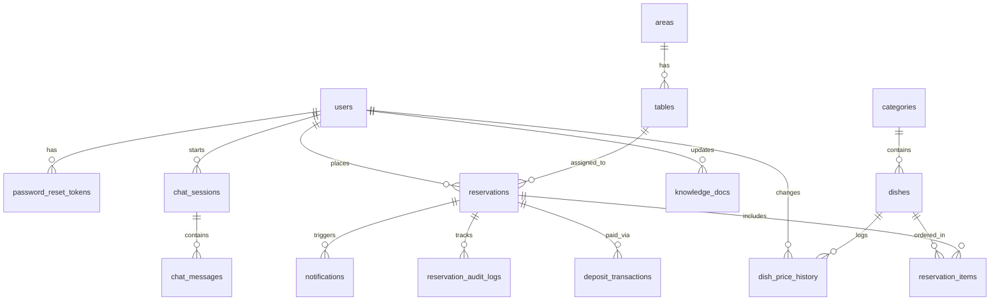

# ĐẶC TẢ HỆ THỐNG (SYSTEM SPECIFICATION)

**Dự án:** Website đặt bàn và đặt món trước cho nhà hàng tích hợp chatbot AI (`QL09-W`)  
**Repository:** `EMENU_23DTHA1_4TL` — Lớp `23DTHA1`, Nhóm `4TL`

> Tài liệu này hợp nhất toàn bộ nội dung từ *Phát biểu bài toán*, *Tôn chỉ dự án (mục tiêu)*, *Phát biểu phạm vi (D02)* và *Software Requirements Specification (SRS) v1.1* thành một nguồn sự thật duy nhất (Single Source of Truth), bổ sung khung **`[Đề xuất kỹ thuật]`** để nhóm Dev Fullstack, AI Dev và AI Agent có thể triển khai trực tiếp mà không thất lạc nghiệp vụ khi lưu trữ/loại bỏ tài liệu Word/Excel gốc.

---

## 1. Thông tin tài liệu & Tổng quan bài toán

### 1.1 Thông tin chung
| Hạng mục | Nội dung chuẩn hóa |
| :--- | :--- |
| **Tên dự án** | Website đặt bàn và đặt món trước cho nhà hàng tích hợp chatbot AI (*Restaurant Table Reservation and Pre-order Website with AI Chatbot*) |
| **Mã đề tài / Khóa Jira** | `QL09-W` \| Khóa dự án Jira thực tế trên repo: **`MC`** *(Lưu ý: tài liệu Word/Excel gốc từng ghi `SCRUM` hoặc `QL`, quy chuẩn GitHub CI & `CONTRIBUTING.md` chạy theo `MC-<số>`)* |
| **Đơn vị áp dụng thực tế** | **Nhà hàng Ẩm thực Vườn Phố** — 1 cơ sở tại TP. Hồ Chí Minh; tiền tệ `VNĐ`; múi giờ chuẩn `GMT+7` |
| **Thời gian thực hiện** | `16/11/2026 – 10/01/2027` (56 ngày lịch, 8 Sprint × 1 tuần); bàn giao `v1.0` ngày `08/01/2027`, bảo vệ & Go-live `10/01/2027` |
| **Ngân sách & Nguồn lực** | `69.987.500 VNĐ` (BAC `63.625.000 VNĐ` + `10%` dự phòng `6.362.500 VNĐ`); 4 thành viên (`640 giờ công`) |
| **Nhóm thực hiện (4 thành viên)** | **Trần Hoàng Phúc** (PM/SM — MSSV: `2380601756`); **Võ Đăng Khoa** (PO/BA); **Nguyễn Văn Tiến** (Dev Fullstack); **Nguyễn Đoàn Trường Vũ** (AI Dev) |
| **Nhà tài trợ (GVHD)** | **Nguyễn Hữu Trung** — Khoa CNTT, HUTECH |
| **Phiên bản & Trạng thái** | `v1.1` (Hợp nhất Markdown chuẩn hóa từ SRS v1.1, Charter D01, Scope D02, Problem Statement) |

### 1.2 Bối cảnh & 6 Vấn đề hiện trạng định lượng
Nhà hàng Ẩm thực Vườn Phố phục vụ tại bàn với nhiều khu vực (tầng trệt, sân vườn, phòng riêng VIP) và thực đơn đa dạng. Quy trình đặt bàn trước hiện thực hiện thủ công qua điện thoại, fanpage Facebook, Zalo và sổ ghi chép/bảng tính rời rạc, phát sinh trung bình **30 – 50 lượt đặt bàn/ngày**:

| STT | Vấn đề tồn tại | Biểu hiện thực tế | Hệ quả |
| :--- | :--- | :--- | :--- |
| 1 | Chỉ nhận đặt bàn trong giờ làm việc | Ngoài giờ không có người trực; tin nhắn khách không được trả lời | Mất khách, thất thoát doanh thu ngoài giờ |
| 2 | Ghi chép thủ công dễ sai sót | Ghi nhầm khung giờ hoặc xếp trùng bàn | Xung đột khi khách đến, giảm uy tín nhà hàng |
| 3 | Khách đặt nhưng không đến (*no-show*) | `10 – 15%` đơn bị hủy hoặc thất thoát; không có đặt cọc và nhắc lịch | Bàn trống không bán được, bếp chuẩn bị thừa |
| 4 | Phản hồi tin nhắn chậm | Khách chờ trung bình `15 – 30 phút` | Khách bỏ sang nhà hàng khác |
| 5 | Câu hỏi lặp lại chiếm đa số | Khoảng `60%` tin nhắn hỏi thực đơn, giá, giờ mở cửa, chính sách cọc/hủy | Nhân viên mất thời gian cho việc lặp lại |
| 6 | Thông tin thực đơn thay đổi | Món hết hoặc đổi giá sau khi khách đã đặt trước | Sai lệch thông tin, phát sinh khiếu nại |

*(Số liệu khảo sát sơ bộ ban đầu được chuẩn hóa bằng biên bản khảo sát thực tế ở Sprint 0 – Sprint 1).*

### 1.3 Mục tiêu & Chỉ tiêu đo lường (KPI)
| Mục tiêu | Chỉ tiêu mục tiêu (KPI) | Cách thức đo lường & kiểm chứng |
| :--- | :--- | :--- |
| **Nhận đặt bàn 24/7** | Ghi nhận rõ số đơn đặt ngoài giờ làm việc | Báo cáo thống kê `FR-12` |
| **Không trùng bàn** | `0%` đơn trùng bàn trên cùng khung giờ; xử lý đúng `100%` yêu cầu đồng thời; giữ chỗ tạm `10 phút` | Concurrent Test trên API/DB (`FR-05`), UAT |
| **Giảm no-show** | Giảm rõ rệt tỷ lệ không đến nhờ đặt cọc `30%` và nhắc lịch tự động `24h` & `2h` | Báo cáo tỷ lệ `Không đến` / đơn đã xác nhận (`FR-12`) |
| **Chatbot AI hiệu quả** | Trả lời đúng `>= 80%` trên bộ `>= 30` câu test (chuẩn & dẫn dụ); phản hồi `<= 5 giây` với `95%` câu hỏi; không lộ PII/ảo giác | Log AI, kết quả kiểm thử `US-40`, phiếu UAT |
| **Giá chốt chính xác** | `100%` đơn đặt trước lưu giá chốt (`unit_price_locked`) tại thời điểm xác nhận; khóa ngay món tạm hết | Test nghiệp vụ `FR-03`, `FR-06` & đối soát bếp `FR-11` |
| **Hiệu năng hệ thống** | Tải trang ban đầu `<= 3 giây` (4G); API nghiệp vụ `<= 2 giây`; chịu `>= 50` người dùng đồng thời | Kiểm thử tải & hiệu năng (`NFR-01`) |
| **Tiến độ – Chi phí** | Bàn giao `v1.0` đúng hạn `08/01/2027` (Go-live `10/01/2027`); `SPI >= 0,9`; `CPI >= 0,9`; trong ngân sách `69.987.500 VNĐ` | MS Project, bảng theo dõi Earned Value (EVM) |
| **Chất lượng & Học thuật** | `100%` US đạt DoD; `0` Bug Nghiêm trọng/Cao khi phát hành; `>= 40` test case chức năng/API; hài lòng UAT `>= 4/5` | Jira (`MC`), Postman, biên bản UAT, Hội đồng |

### 1.4 Phạm vi hệ thống (In-Scope, Mở rộng & Out-of-Scope)
- **Trong phạm vi MVP (`45 User Story = 202 SP`, từ `FR-01` đến `FR-14` + lõi `FR-15`):**
  - Xác thực & phân quyền RBAC 3 vai trò: Khách hàng, Nhân viên, Quản lý (`FR-01`).
  - Xem, tìm kiếm, lọc và quản lý thực đơn, tình trạng món, lịch sử đổi giá (`FR-02`, `FR-03`).
  - Quản lý khu vực, sơ đồ bàn kéo thả và xem trạng thái bàn theo ngày/giờ (`FR-04`).
  - Đặt bàn theo khung giờ (`30p` bước, `90p` lượt, trước `2h–30 ngày`, `GMT+7`), giữ chỗ `10p`, chống trùng bàn ở DB (`FR-05`).
  - Đặt món trước với giá chốt, đặt cọc trực tuyến qua cổng Sandbox (callback/webhook HMAC), hủy & hoàn cọc (`FR-06`, `FR-07`, `FR-09`).
  - Vận hành đặt chỗ cho nhân viên (check-in, đổi bàn/giờ, đánh dấu no-show), thông báo & nhắc lịch `24h`/`2h`, tổng hợp món chuẩn bị cho bếp (`FR-08`, `FR-10`, `FR-11`).
  - Báo cáo thống kê vận hành (`FR-12`).
  - Chatbot AI (Ollama) tư vấn món kèm thẻ món, giải đáp chính sách dựa trên RAG, hỗ trợ đặt bàn qua chat (`FR-13`, `FR-14`).
- **Mở rộng — Backlog dự phòng (`9 User Story = 50 SP`, chỉ kéo vào nếu velocity vượt kế hoạch trước mốc đóng băng tính năng hết Sprint 6):**
  - Quản trị tri thức & giám sát chatbot nâng cao (`FR-15` — `US-46`, ưu tiên dự phòng #1), Đặt tiệc/sự kiện (`FR-16`), Đánh giá nhà hàng 1–5 sao (`FR-17`), Chatbot thao tác qua API có xác nhận — tool calling (`FR-18`), cùng các story mở rộng `US-47`–`US-50`.
- **Ngoài phạm vi (Out of Scope — Tuyệt đối không triển khai):**
  1. Ứng dụng di động cài đặt riêng trên iOS/Android (chỉ làm Website Responsive).
  2. Thanh toán toàn bộ hóa đơn tại bàn (POS) và xuất hóa đơn GTGT (VAT).
  3. Quản lý kho, định lượng nguyên vật liệu, nhân sự và chấm công.
  4. Đặt món giao hàng tận nơi (delivery) và mua mang đi (take-away).
  5. Giao dịch thanh toán bằng tiền thật (chỉ tích hợp cổng Sandbox).
  6. Xây dựng, huấn luyện hoặc tinh chỉnh (fine-tune) mô hình LLM; chatbot tự ý hoàn tiền, đổi đơn hoặc cấp mã giảm giá khi chưa có xác nhận và kiểm tra phía server.

### 1.5 Giả định, Ràng buộc, Phụ thuộc & Make-or-Buy
- **Ràng buộc**: Bộ công nghệ chuẩn hóa (ReactJS, Python FastAPI, PostgreSQL, Ollama); cấm gửi PII lên dịch vụ AI; không lưu số thẻ thanh toán; HTTPS + mật khẩu băm; Scrum 8 Sprint (20h/người/Sprint, tổng 640h); mọi thay đổi sau Baseline `M2 (29/11/2026)` phải qua CR & Hội đồng CCB.
- **Giả định**: Nhà hàng vận hành 1 cơ sở; tiếng Việt, `VNĐ`, `GMT+7`; tham số mặc định cấu hình động bởi Quản lý; dữ liệu mẫu ẩn danh `>= 30–50` món do nhà hàng cung cấp.
- **Phụ thuộc**: Nhà hàng cung cấp thực đơn/sơ đồ bàn/chính sách đúng hạn đầu Sprint 0–2 và cử đại diện dự Sprint Review, UAT Sprint 7; Sandbox, VPS, Ollama, SMTP/SMS sẵn sàng suốt dự án.

**Phân tích Tự làm hay Mua/Thuê (Make-or-Buy):**
| Thành phần / Dịch vụ | Vai trò | Quyết định & Lý do |
| :--- | :--- | :--- |
| **Mô hình LLM (Ollama)** | Hiểu tiếng Việt, tư vấn món & dẫn đặt bàn | **Tự triển khai (Self-host)** mô hình mở qua Ollama trên VPS: chi phí API = `0 VNĐ`, kiểm soát dữ liệu nội bộ, chốt model tại `US-15` (Sprint 2). |
| **Cổng thanh toán** | Thu tiền cọc & đối soát hoàn cọc | **Thuê Sandbox** (VNPay/MoMo/PayOS miễn phí): đảm bảo chuẩn bảo mật, không lưu số thẻ trên hệ thống. |
| **Cloud / VPS** | Chạy Web App (React, FastAPI, PG) + Ollama | **Thuê Cloud/VPS** 45 ngày (Sprint 4–7): `1.125.000 VNĐ`, đóng gói Docker dễ backup/di chuyển. |
| **Email & SMS** | Xác nhận, hủy đơn & nhắc lịch `24h`/`2h` | **SMTP Email** miễn phí/cơ bản + **gói SMS thử nghiệm** (`200.000 VNĐ`) chỉ cho mốc nhắc `2h` để kiểm soát chi phí. |

### 1.6 Định nghĩa thuật ngữ & từ viết tắt
| Thuật ngữ | Giải thích |
| :--- | :--- |
| **SRS / MVP** | Software Requirements Specification / Minimum Viable Product (tập chức năng tối thiểu bắt buộc). |
| **FR / NFR** | Functional Requirement (`FR-xx`) / Non-Functional Requirement (`NFR-xx`). |
| **Đơn đặt chỗ** | Bản ghi gồm khách, bàn, khung giờ, số khách, món đặt trước (nếu có) và giao dịch cọc. |
| **Khung giờ** | Khoảng thời gian dùng bàn, chia theo bước `30 phút`, lượt phục vụ mặc định `90 phút`. |
| **Tiền cọc** | Khoản thanh toán trực tuyến trước để giữ chỗ, trừ trực tiếp vào hóa đơn khi dùng bữa. |
| **Giữ chỗ tạm thời** | Cơ chế khóa giữ bàn ngắn hạn (mặc định `10 phút`) trong lúc khách thanh toán cọc. |
| **No-show** | Khách đã đặt chỗ và cọc nhưng không đến dùng bữa (quá `15 phút`) và không báo hủy. |
| **Ollama / RAG** | Hạ tầng chạy LLM mã nguồn mở tự host / Retrieval-Augmented Generation (truy xuất DB thật trước khi sinh câu trả lời). |
| **Hallucination** | Hiện tượng AI bịa thông tin sai lệch hoặc không có trong dữ liệu nhà hàng. |
| **PII Masking** | Che/loại bỏ thông tin định danh cá nhân (họ tên, SĐT, email) trước khi gửi ngữ cảnh lên LLM. |
| **Tool calling** | Cơ chế AI gọi API nghiệp vụ nằm trong danh sách whitelist có kiểm tra quyền phía server. |
| **UAT** | User Acceptance Test — Kiểm thử nghiệm thu thực tế bởi Nhà hàng Ẩm thực Vườn Phố. |

---

## 2. Kiến trúc hệ thống, Tech Stack & Cấu trúc dự án

### 2.1 Kiến trúc tổng quan (Client–Server + AI + External Services)


### 2.2 Tech Stack (`[SRS Chốt]` vs `[Đề xuất kỹ thuật cho Sprint 1]`)
| Tầng | `[SRS Chốt]` (Bắt buộc) | `[Đề xuất kỹ thuật cho Sprint 1]` (Để Dev code ngay) |
| :--- | :--- | :--- |
| **Front-end** | ReactJS (Responsive Web Mobile & Desktop) | React 18 + Vite + TypeScript + Tailwind CSS + React Router v6 + TanStack Query + Axios + Vitest |
| **Back-end** | Python FastAPI, OpenAPI/Swagger, JWT, RBAC | Python 3.12 + SQLAlchemy 2.0 + Pydantic v2 + Pytest + APScheduler (job hết hạn giữ chỗ 10p & nhắc lịch 24h/2h) |
| **Database** | PostgreSQL + Alembic (ERD `>= 8` bảng, DB constraint chống trùng) | PostgreSQL 16 + extension `btree_gist` (`EXCLUDE USING GIST` chống trùng khung giờ) |
| **Chatbot AI** | Ollama self-host (không fine-tune), RAG từ PostgreSQL, PII Masker, GMT+7 parser | Benchmark chốt model tối ưu tiếng Việt & RAM/VRAM tại `US-15` (VD: `qwen2.5:7b-instruct` / `llama3.1:8b`) |
| **Thanh toán & TB** | Sandbox (VNPay/MoMo/PayOS) HMAC, Email SMTP & SMS | Chốt 1 cổng Sandbox ở Sprint 1; `smtplib`/Mailtrap cho Staging; SMS gateway thử nghiệm cho mốc `2h` |
| **Triển khai & CI** | Docker, Cloud/VPS (Staging & Prod), GitHub Actions | `docker-compose.yml` (Core) + `docker-compose.ollama.yml` (AI), Nginx reverse proxy HTTPS |

### 2.3 Cấu trúc thư mục & Phân vùng Zero File-Overlap
```text
EMENU_QLDA/
├── AGENTS.md
├── CONTRIBUTING.md
├── docker-compose.yml              # [Dev Fullstack] FE + Core BE + PostgreSQL
├── docker-compose.ollama.yml       # [AI Dev] Container Ollama
├── frontend/                       # [Dev Fullstack] ReactJS + ChatWidget + /booking pre-fill
├── backend/
│   ├── alembic/versions/           # Core migrations (FS) | *_ai_* migrations (AI Dev)
│   ├── scripts/
│   │   ├── seed_core.py            # [Dev Fullstack] Nạp menu, khu vực, bàn mẫu ẩn danh
│   │   └── seed_ai.py              # [AI Dev] Nạp knowledge_docs, FAQ mẫu
│   ├── tests/
│   │   ├── core/                   # [Dev Fullstack / QA] Test nghiệp vụ & concurrent booking
│   │   └── ai/                     # [AI Dev / QA] Test PII Masker, GMT+7 parser, 30+ câu AI
│   └── app/
│       ├── core/                   # [Dev Fullstack] Config, security (JWT/RBAC), DB session
│       ├── models/
│       │   ├── core_models.py      # [Dev Fullstack] 13 bảng Core
│       │   └── ai_models.py        # [AI Dev] 3 bảng AI (không sửa core_models.py)
│       ├── services/               # [Dev Fullstack] availability_service, reservation, payment...
│       ├── ai/                     # [AI Dev] ollama_client, rag_retriever, pii_masker, guardrails, datetime_parser, booking_assistant
│       └── api/v1/
│           ├── ...                 # [Dev Fullstack] auth, menu, tables, reservations, payments, kitchen, reports, configs
│           └── chat_router.py      # [AI Dev] /api/v1/chat/* (chỉ gọi read-only availability_service)
└── docs/
    ├── SYSTEM_SPEC.md
    ├── ROADMAP.md
    ├── SESSION_LOG.md
    └── references/                 # Bản lưu tạm tài liệu Word/Excel gốc
```

### 2.4 Tham số nghiệp vụ mặc định (Cấu hình động bởi Quản lý — `US-20`)
*(Thay đổi tham số chỉ áp dụng cho đơn mới, không ảnh hưởng ngược đơn đã tạo.)*

| Tham số | Giá trị mặc định | Ghi chú nghiệp vụ |
| :--- | :--- | :--- |
| Múi giờ & Tiền tệ | `GMT+7`, `VNĐ` | Chuẩn hóa toàn hệ thống |
| Bước khung giờ & Lượt phục vụ | Bước `30 phút`, lượt `90 phút` | Chặn chồng lấn khung giờ trên cùng bàn |
| Khoảng thời gian đặt trước | Tối thiểu `2 giờ`, tối đa `30 ngày` | Tính từ thời điểm đặt theo `GMT+7` |
| Thời gian giữ chỗ tạm thời | `10 phút` | Hết hạn tự động chuyển `Hết hạn` & giải phóng bàn |
| Hạn chót sửa/hủy món đặt trước | `2 giờ` trước giờ hẹn | Số lượng mỗi món `1 – 20 phần` |
| Tiền cọc mặc định | `30%` giá trị món đặt trước | Có mức cố định tối thiểu theo số khách nếu không đặt món |
| Chính sách hoàn cọc khi hủy | `>= 24h`: `100%`; `2h – < 24h`: `50%`; `< 2h` / No-show: `0%` | Hiển thị rõ trước khi khách xác nhận cọc/hủy |
| Nhắc lịch tự động | Trước `24 giờ` (Email) & `2 giờ` (Email + SMS nếu bật) | Retry tối đa `3 lần` nếu lỗi |
| Cảnh báo trễ check-in (No-show) | Quá `15 phút` sau giờ hẹn | Nhắc Nhân viên đánh dấu `Không đến` |
| Lưu trữ lịch sử hội thoại AI | Tối đa `90 ngày` | Che PII khi hiển thị cho Quản lý |

---

## 3. Kiến trúc Chatbot AI — 5 Lớp quyết định

| Lớp quyết định | Quy định thiết kế & tiêu chí kiểm soát đã chốt |
| :--- | :--- |
| **1. Kết quả (Outcome)** | Trả lời câu hỏi thường gặp về thực đơn, giá, giờ mở cửa, chính sách cọc/hủy và dẫn dắt đặt bàn tức thì (`<= 5 giây`) `24/7`, giảm tải tin nhắn lặp lại cho lễ tân. |
| **2. Dữ liệu (Data & RAG)** | Chỉ truy xuất từ dữ liệu thực tế đã duyệt trong PostgreSQL (món `Đang bán`, giá hiện hành, còn/hết, bàn trống, giờ mở cửa, chính sách, FAQ). Toàn bộ PII (họ tên, SĐT, email) bị loại bỏ/che (**PII Masking**) trước khi gửi sang LLM. |
| **3. Mô hình (Model)** | Dùng mô hình LLM mã nguồn mở có sẵn chạy tự chủ trên **Ollama** (chốt model ở Sprint 2 `US-15`, không huấn luyện/fine-tune). Đạt độ chính xác `>= 80%` trên bộ `>= 30` câu test (chuẩn & dẫn dụ), phản hồi `<= 5 giây` với `95%` truy vấn. |
| **4. Tích hợp (Integration)** | Nhúng `ChatWidget` ReactJS trên các trang chính; giao tiếp REST API `/api/v1/chat/*`; gọi dịch vụ kiểm tra bàn trống `FR-05` ở chế độ **chỉ đọc** để sinh link điền sẵn `/booking?...` (mở rộng `FR-18` tool calling có xác nhận). Gặp câu hỏi ngoài phạm vi hoặc khiếu nại/dị ứng → hướng dẫn liên hệ nhân viên. |
| **5. Quản trị (Governance & Guardrails)** | Chống bịa thông tin (*hallucination*); từ chối lịch sự ngoài phạm vi; **không cam kết y tế/dị ứng**; **không báo "đã đặt thành công"** khi chưa có xác nhận server; rate limit & giới hạn độ dài tin nhắn; fallback `is_fallback: true` khi Ollama lỗi/timeout; lưu log tối đa `90 ngày` (che PII). |

---

## 4. Tác nhân, Ma trận phân quyền & Vòng đời đơn đặt chỗ

### 4.1 Tác nhân hệ thống (6 tác nhân)
| Tác nhân | Mô tả | Quyền hạn chính |
| :--- | :--- | :--- |
| **Khách vãng lai** | Người truy cập chưa đăng nhập | Xem/tìm thực đơn, hỏi chatbot tư vấn, đăng ký/đăng nhập |
| **Khách hàng** | Người dùng đã đăng nhập (`customer`) | Đặt bàn, đặt món trước, cọc trực tuyến, xem/hủy đơn, đặt bàn qua chat |
| **Nhân viên** | Lễ tân, phục vụ, bếp (`staff`) | Xem sơ đồ bàn theo giờ, cập nhật món còn/hết, xử lý đơn (check-in, đổi bàn/giờ, no-show), xem/in danh sách món bếp |
| **Quản lý** | Chủ/Quản lý nhà hàng (`manager`) | Toàn quyền thực đơn, sơ đồ bàn, tham số nghiệp vụ, tài khoản nhân viên, báo cáo, hủy ngoại lệ, quản trị tri thức & giám sát chatbot |
| **Chatbot AI** | Trợ lý hội thoại Ollama + RAG | Truy xuất dữ liệu thật, gợi ý món kèm thẻ món, tra cứu bàn trống (chỉ đọc) & tạo link `/booking?...` |
| **Hệ thống ngoài** | Sandbox Payment, Ollama, Email/SMS | Xử lý cọc qua webhook/callback HMAC, sinh câu trả lời ngôn ngữ tự nhiên, gửi thông báo |

### 4.2 Ma trận phân quyền (4 vai trò × 18 FR)
*(Ký hiệu: `X` = sử dụng đầy đủ; `Xem` = chỉ xem; `Một phần` = giới hạn nghiệp vụ; `Nhận` / `Cấu hình` = nhận hoặc cấu hình thông báo.)*

| Mã | Tên chức năng | Khách vãng lai | Khách hàng | Nhân viên | Quản lý |
| :--- | :--- | :---: | :---: | :---: | :---: |
| `FR-01` | Xác thực và phân quyền | X | X | X | X |
| `FR-02` | Xem và tìm kiếm thực đơn | X | X | | |
| `FR-03` | Quản lý thực đơn | | | Một phần | X |
| `FR-04` | Quản lý sơ đồ bàn | | | Xem | X |
| `FR-05` | Đặt bàn theo khung giờ và số khách | | X | | |
| `FR-06` | Đặt món trước | | X | | |
| `FR-07` | Đặt cọc trực tuyến | | X | | |
| `FR-08` | Quản lý đặt chỗ | | | X | X |
| `FR-09` | Hủy đặt chỗ và hoàn cọc | | X | Một phần | X |
| `FR-10` | Thông báo và nhắc lịch | | Nhận | Nhận | Cấu hình |
| `FR-11` | Tổng hợp món chuẩn bị cho bếp | | | X | X |
| `FR-12` | Báo cáo thống kê | | | | X |
| `FR-13` | Chatbot tư vấn món và giải đáp | X | X | | |
| `FR-14` | Chatbot hỗ trợ đặt bàn | | X | | |
| `FR-15` | Quản trị và giám sát chatbot | | | | X |
| `FR-16` | Đặt tiệc / sự kiện *(Mở rộng)* | | X | Xem | X |
| `FR-17` | Đánh giá nhà hàng *(Mở rộng)* | | X | | X |
| `FR-18` | Chatbot thao tác qua API *(Mở rộng)* | | X | | |

### 4.3 Vòng đời 7 trạng thái đơn đặt chỗ


| Trạng thái | Ý nghĩa nghiệp vụ | Trạng thái kế tiếp hợp lệ | Tác nhân kích hoạt |
| :--- | :--- | :--- | :--- |
| **Chờ cọc** (`pending_deposit`) | Đơn khởi tạo, bàn khóa giữ tạm `10 phút` | `Đã xác nhận`, `Hết hạn`, `Đã hủy` | Hệ thống (cọc/hết hạn); Khách (hủy) |
| **Đã xác nhận** (`confirmed`) | Đã cọc thành công, bàn giữ chính thức | `Đã đến`, `Đã hủy`, `Không đến` | NV (check-in / no-show); Khách/NV/QL (hủy) |
| **Đã đến** (`checked_in`) | Khách đã đến, đang phục vụ | `Hoàn thành` | Nhân viên |
| **Hoàn thành** (`completed`) | Dùng bữa xong, đủ điều kiện đánh giá | *(Trạng thái cuối)* | Nhân viên |
| **Đã hủy** (`cancelled`) | Đơn bị hủy, bàn được giải phóng | *(Trạng thái cuối)* | Khách hàng, Nhân viên, Quản lý |
| **Không đến** (`no_show`) | Quá `15 phút` chưa check-in, không báo hủy | *(Trạng thái cuối)* | Nhân viên |
| **Hết hạn** (`expired`) | Quá `10 phút` giữ chỗ chưa cọc | *(Trạng thái cuối)* | Hệ thống (tự động) |

---

## 5. Đặc tả chi tiết 18 Yêu cầu chức năng (`FR-01` – `FR-18`)

### 5.1 Nhóm Tài khoản (`FR-01`)
- **`FR-01` — Xác thực và phân quyền** | *Ưu tiên:* `MVP – hỗ trợ` | *Epic/US:* `EP-01` (`US-04`, `US-05`, `US-06`, `US-07`)
  - **Tác nhân**: Khách vãng lai, Khách hàng, Nhân viên, Quản lý.
  - **Luồng chính**: Đăng ký (họ tên, SĐT, email, mật khẩu) → kiểm tra duy nhất email/SĐT → tạo tài khoản `customer` + gửi email xác thực → đăng nhập bằng email/SĐT → cấp JWT có thời hạn và điều hướng theo vai trò.
  - **Ngoại lệ**: Trùng email/SĐT → báo lỗi gợi ý đăng nhập; sai mật khẩu `> 5 lần` liên tiếp → khóa tạm `15 phút`; quên mật khẩu → gửi link đặt lại có thời hạn, dùng `1 lần` qua email; truy cập ngoài quyền → `HTTP 403` + ghi nhật ký.
  - **Quy tắc**: 3 vai trò (`customer`, `staff`, `manager`), tài khoản Nhân viên/Quản lý do Quản lý tạo/khóa/mở khóa; vãng lai xem menu/hỏi bot nhưng đặt bàn/cọc phải đăng nhập; mật khẩu băm một chiều, truyền tải HTTPS.

### 5.2 Nhóm Thực đơn (`FR-02`, `FR-03`)
- **`FR-02` — Xem và tìm kiếm thực đơn** | *Ưu tiên:* `MVP (bắt buộc)` | *Epic/US:* `EP-02` (`US-09`, `US-10`)
  - **Tác nhân**: Khách vãng lai, Khách hàng (không cần đăng nhập).
  - **Luồng chính**: Xem danh mục & món đang bán (ảnh, mô tả, giá `VNĐ`, nhãn món); tìm từ khóa, lọc theo danh mục, khoảng giá, nhãn (`chay`, `cay`, `hải sản`...); xem chi tiết và thêm vào đơn đặt trước (`FR-06`).
  - **Ngoại lệ**: Không có kết quả → thông báo & gợi ý bỏ bớt bộ lọc; món `Tạm hết` → hiển thị nhãn và khóa nút thêm vào đơn.
  - **Quy tắc**: Chỉ hiện món `Đang bán` hoặc `Tạm hết`; là nguồn dữ liệu duy nhất để chatbot tư vấn (`FR-13`).

- **`FR-03` — Quản lý thực đơn** | *Ưu tiên:* `MVP (bắt buộc)` | *Epic/US:* `EP-02` (`US-11`, `US-12`, dự phòng `US-49`)
  - **Tác nhân**: Quản lý (Nhân viên chỉ đổi tình trạng còn/hết).
  - **Luồng chính**: Thêm, sửa, ẩn (xóa mềm) danh mục và món; validate tên không rỗng, giá `> 0`, ảnh đúng định dạng/dung lượng; cập nhật trạng thái (`Đang bán` / `Tạm hết` / `Ngừng bán`); tự động lưu lịch sử đổi giá (người sửa, thời điểm, giá cũ, giá mới); đồng bộ ngay ra giao diện & RAG.
  - **Ngoại lệ**: Món nằm trong đơn chưa hoàn thành → cấm xóa vật lý, chỉ cho `Ngừng bán`; ảnh sai định dạng/quá dung lượng → báo lỗi, không lưu.
  - **Quy tắc**: Xóa mềm, không xóa món đã phát sinh đơn; đơn đã đặt giữ nguyên `unit_price_locked`; khi món chuyển `Hết`/`Ngừng bán` mà có đơn đặt trước → đánh dấu & cảnh báo nhân viên liên hệ khách đổi món (`US-49`).

### 5.3 Nhóm Sơ đồ bàn và Đặt bàn (`FR-04`, `FR-05`)
- **`FR-04` — Quản lý sơ đồ bàn** | *Ưu tiên:* `MVP (bắt buộc)` | *Epic/US:* `EP-03` (`US-13`, `US-14`, `US-23`)
  - **Tác nhân**: Quản lý (Nhân viên chỉ xem).
  - **Luồng chính**: Tạo khu vực (tầng 1, sân vườn, VIP...); thêm/sửa bàn (mã bàn, sức chứa `>= 1`, khu vực, đánh dấu bàn có thể ghép); kéo thả sắp xếp tọa độ trên sơ đồ; chọn ngày/giờ xem 5 trạng thái bàn (`Trống`, `Đang giữ`, `Đã đặt`, `Đang phục vụ`, `Ngưng sử dụng`).
  - **Ngoại lệ**: Trùng mã bàn trong cơ sở → báo lỗi; xóa/ngưng bàn đang có đơn tương lai → chặn và yêu cầu chuyển bàn cho đơn đó trước.
  - **Quy tắc**: Bàn `Ngưng sử dụng` không nhận đơn mới; làm cơ sở tính bàn trống cho `FR-05`.

- **`FR-05` — Đặt bàn theo khung giờ và số khách** | *Ưu tiên:* `MVP (bắt buộc)` | *Epic/US:* `EP-03` (`US-17`, `US-18`, `US-19`, `US-20`)
  - **Tác nhân**: Khách hàng (đã đăng nhập; có ít nhất 1 bàn hoạt động).
  - **Luồng chính**: Nhập ngày, giờ, số khách, khu vực ưa thích, ghi chú → kiểm tra bàn trống phù hợp → hiển thị khung giờ còn bàn & bàn gợi ý → chọn khung giờ/bàn → tạo đơn `Chờ cọc` và giữ bàn `10 phút` kèm đồng hồ đếm ngược → chuyển sang đặt món (`FR-06`) & cọc (`FR-07`).
  - **Ngoại lệ**: Hết bàn → gợi ý khung giờ gần nhất hoặc khu vực khác; hết `10 phút` chưa cọc → tự chuyển `Hết hạn` & giải phóng bàn; hai khách đặt cùng bàn/khung giờ đồng thời → người giữ trước thành công, người sau nhận thông báo & gợi ý khác; số khách vượt sức chứa 1 bàn → đề xuất ghép bàn hoặc đặt tiệc (`FR-16`).
  - **Quy tắc**: Bước `30p`, lượt `90p`, đặt trước `2h – 30 ngày`, múi giờ `GMT+7`; kiểm tra và giữ bàn PHẢI nằm trong cùng DB transaction có constraint chống trùng bàn.

### 5.4 Nhóm Đặt món trước, Đặt cọc & Hủy/Hoàn cọc (`FR-06`, `FR-07`, `FR-09`)
- **`FR-06` — Đặt món trước** | *Ưu tiên:* `MVP (bắt buộc)` | *Epic/US:* `EP-04` (`US-21`, `US-22`)
  - **Tác nhân**: Khách hàng (có đơn `Chờ cọc` hoặc `Đã xác nhận` còn trong hạn sửa món).
  - **Luồng chính**: Duyệt thực đơn, thêm/sửa/xóa món (SL `1–20`), ghi chú từng món → tính tạm tính → xác nhận danh sách món → lưu giá chốt (`unit_price_locked`), tổng tiền & tiền cọc yêu cầu.
  - **Ngoại lệ**: Món hết trong lúc đặt → thông báo & loại khỏi danh sách; không đặt món → đơn vẫn hợp lệ, tính cọc theo quy tắc không có món; sửa món sau khi đã cọc (trước hạn `2h`) → tính lại tiền cọc & xử lý chênh lệch.

- **`FR-07` — Đặt cọc trực tuyến** | *Ưu tiên:* `MVP (bắt buộc)` | *Epic/US:* `EP-04` (`US-20`, `US-24`, `US-25`)
  - **Tác nhân**: Khách hàng, Cổng thanh toán Sandbox (đơn ở trạng thái `Chờ cọc` còn hạn giữ).
  - **Luồng chính**: Hiển thị tóm tắt đơn & chính sách hủy → khách đồng ý → tạo giao dịch & chuyển sang cổng Sandbox → nhận callback/webhook → xác thực chữ ký HMAC → đơn chuyển `Đã xác nhận`, sinh mã đặt chỗ, gửi thông báo (`FR-10`).
  - **Ngoại lệ**: Thanh toán thất bại/hủy → giữ `Chờ cọc` đến hết hạn giữ chỗ để thử lại; callback thành công **đến muộn sau khi đơn hết hạn** → nếu bàn còn trống thì xác nhận, nếu bàn đã mất thì tự động đánh dấu hoàn cọc & báo khách; callback gửi trùng → xử lý **idempotent** (không ghi nhận cọc 2 lần); cổng không phản hồi → báo lỗi, không ghi cọc.
  - **Quy tắc**: Cọc mặc định `30%` giá trị món (hoặc mức tối thiểu theo số khách); không lưu số thẻ; khoản cọc hiển thị để nhân viên trừ vào hóa đơn tại bàn.

- **`FR-09` — Hủy đặt chỗ và hoàn cọc** | *Ưu tiên:* `MVP – hỗ trợ` | *Epic/US:* `EP-04` (`US-20`, `US-26`, dự phòng `US-48`)
  - **Tác nhân**: Khách hàng; Nhân viên, Quản lý (xử lý ngoại lệ).
  - **Luồng chính**: Khách mở *Đặt chỗ của tôi* → chọn Hủy → xem mức hoàn cọc theo chính sách → xác nhận hủy → đơn chuyển `Đã hủy`, giải phóng bàn, tạo yêu cầu hoàn cọc (nếu có) & gửi thông báo (`FR-10`).
  - **Ngoại lệ**: Hủy trong khoảng `< 2h` không hoàn cọc → cảnh báo mất cọc trước khi xác nhận; hoàn cọc qua cổng lỗi → chuyển `Chờ xử lý thủ công` để Quản lý xử lý.
  - **Quy tắc**: Trước `>= 24h` hoàn `100%`; `2h – < 24h` hoàn `50%`; `< 2h` & `Không đến` hoàn `0%`.

### 5.5 Nhóm Vận hành, Thông báo & Bếp (`FR-08`, `FR-10`, `FR-11`)
- **`FR-08` — Quản lý đặt chỗ** | *Ưu tiên:* `MVP (bắt buộc)` | *Epic/US:* `EP-05` (`US-31`, `US-32`, `US-33`, dự phòng `US-50`)
  - **Tác nhân**: Nhân viên, Quản lý.
  - **Luồng chính**: Lọc đơn theo ngày, trạng thái, khu vực, mã đơn, SĐT → xem chi tiết (khách, bàn, món, cọc, lịch sử) → thao tác: đổi bàn/giờ, ghi chú, hủy, check-in (`Đã đến`), `Hoàn thành`, đánh dấu `Không đến` → đồng bộ sơ đồ bàn & gửi thông báo.
  - **Ngoại lệ**: Đổi sang bàn/giờ trùng → chặn; hủy đơn đã cọc ngoại lệ → chỉ Quản lý, bắt buộc ghi lý do; thao tác trên đơn ở trạng thái cuối → chặn; đặt qua điện thoại (`US-50` dự phòng) → tạo đơn thay khách & gửi link cọc.
  - **Quy tắc**: Ghi audit log (người thực hiện, thời điểm, giá trị cũ/mới); quá `15 phút` chưa check-in → hệ thống nhắc nhân viên xử lý.

- **`FR-10` — Thông báo và nhắc lịch** | *Ưu tiên:* `MVP – hỗ trợ` | *Epic/US:* `EP-05` (`US-27`, `US-38`)
  - **Tác nhân**: Hệ thống; Khách hàng, Nhân viên (nhận); Quản lý (cấu hình).
  - **Luồng chính**: Bắt sự kiện (xác nhận, đổi, hủy, mốc nhắc `24h`/`2h`) → chọn mẫu & kênh (Email hoặc SMS cho mốc `2h`) → gửi & ghi log vào chi tiết đơn.
  - **Ngoại lệ**: Gửi lỗi → retry tối đa `3 lần`, vẫn lỗi thì ghi log & cảnh báo; SĐT không hợp lệ → fallback sang Email. Không gửi nhắc cho đơn đã hủy.

- **`FR-11` — Tổng hợp món chuẩn bị cho bếp** | *Ưu tiên:* `MVP – hỗ trợ` | *Epic/US:* `EP-05` (`US-37`)
  - **Tác nhân**: Nhân viên, Quản lý.
  - **Luồng chính**: Chọn ngày & ca/khung giờ → tổng hợp món, số lượng, ghi chú chỉ từ các đơn `Đã xác nhận` → xem, in hoặc xuất PDF; đánh dấu đã chuẩn bị (tùy chọn).
  - **Ngoại lệ**: Đơn bị hủy/sửa sau khi in → hệ thống cập nhật và nêu rõ thay đổi.

### 5.6 Nhóm Báo cáo (`FR-12`)
- **`FR-12` — Báo cáo thống kê** | *Ưu tiên:* `MVP (bắt buộc)` | *Epic/US:* `EP-06` (`US-36`, dự phòng `US-47`)
  - **Tác nhân**: Quản lý.
  - **Luồng chính**: Chọn loại báo cáo, khoảng thời gian (`GMT+7`), bộ lọc → hiển thị bảng & biểu đồ: số đơn theo trạng thái, tỷ lệ hủy, tỷ lệ `no-show` (`= số đơn Không đến / số đơn Đã xác nhận đã qua giờ hẹn`), doanh thu cọc/hoàn cọc, số đơn đặt ngoài giờ làm việc. (Mở rộng `US-47`: món đặt nhiều nhất, công suất bàn, thống kê chatbot, xuất Excel/PDF).
  - **Ngoại lệ**: Khoảng thời gian `> 1 năm` → yêu cầu thu hẹp; không có dữ liệu → thông báo rõ.

### 5.7 Nhóm Chatbot AI (`FR-13`, `FR-14`, `FR-15`)
- **`FR-13` — Chatbot tư vấn món và giải đáp thông tin** | *Ưu tiên:* `MVP (bắt buộc)` | *Epic/US:* `EP-07` (`US-15`, `US-29`, `US-30`, `US-34`, `US-40`)
  - **Tác nhân**: Khách vãng lai, Khách hàng; Máy chủ Ollama.
  - **Luồng chính**: Mở khung chat (chatbot nêu rõ là trợ lý AI) → đặt câu hỏi (gợi ý món theo ngân sách/số người/nhãn, giờ mở cửa, địa chỉ, chính sách cọc/hủy) → hệ thống RAG truy xuất thực đơn & chính sách từ PostgreSQL → Ollama sinh câu trả lời tiếng Việt kèm thẻ món (`tên`, `giá`, `ảnh`, nút `Thêm vào đơn`) → lưu hội thoại & cho phép đánh giá `Hữu ích` / `Không hữu ích`.
  - **Ngoại lệ**: Câu hỏi ngoài phạm vi → từ chối lịch sự; thiếu dữ liệu → nói chưa có thông tin & hướng dẫn liên hệ nhân viên; Ollama lỗi/timeout → thông báo fallback & điều hướng sang thực đơn/form đặt bàn.
  - **Quy tắc**: Không bịa thông tin; che PII (họ tên, SĐT, email) trước khi gửi LLM; từ chối cam kết y tế/dị ứng; rate limit & giới hạn độ dài tin nhắn.

- **`FR-14` — Chatbot hỗ trợ đặt bàn qua hội thoại** | *Ưu tiên:* `MVP (bắt buộc)` | *Epic/US:* `EP-07` (`US-35`, `US-40`)
  - **Tác nhân**: Khách hàng (hỗ trợ giữ state qua bước đăng nhập nếu chưa đăng nhập).
  - **Luồng chính**: Khách nêu nhu cầu đặt bàn → bot thu thập lần lượt (slot-filling) ngày, giờ, số khách, khu vực → chuẩn hóa ngày giờ tự nhiên sang `GMT+7` & hiển thị lại xác nhận → gọi read-only dịch vụ bàn trống `FR-05` → sinh link điền sẵn `/booking?...` để khách kiểm tra, đặt món & cọc theo `FR-05..FR-07`.
  - **Ngoại lệ**: Chưa đăng nhập → yêu cầu đăng nhập và giữ nguyên thông tin đã nhập; hết bàn → đề xuất khung giờ/khu vực khác; ngày giờ ngoài phạm vi (`2h–30 ngày` hoặc quá khứ) → giải thích và hỏi lại.
  - **Quy tắc**: Tuyệt đối không báo "đã đặt thành công" khi hệ thống chưa xác nhận đơn.

- **`FR-15` — Quản trị tri thức và giám sát chatbot** | *Ưu tiên:* `MVP – hỗ trợ` | *Epic/US:* `EP-07` (`US-46` — Backlog dự phòng ưu tiên #1)
  - **Tác nhân**: Quản lý.
  - **Luồng chính**: Thêm/sửa giờ mở cửa, địa chỉ, chính sách, FAQ (áp dụng ngay vào RAG); xem lịch sử hội thoại (che PII, lưu tối đa `90 ngày`), lọc phản hồi `Không hữu ích` hoặc cần chuyển nhân viên, đánh dấu câu sai & ghi chú cải thiện.

### 5.8 Nhóm Mở rộng — Backlog dự phòng (`FR-16`, `FR-17`, `FR-18`)
- **`FR-16` — Đặt tiệc / sự kiện** (`EP-08`, `US-54`, `Mở rộng`): Khách gửi yêu cầu nhóm đông (loại sự kiện, ngày giờ, số khách, ngân sách) → `Chờ duyệt` → Quản lý báo giá & đặt mức cọc riêng → khách xác nhận & cọc (dùng chung cơ chế giữ bàn `FR-05`; báo giá quá hạn tự hết hạn).
- **`FR-17` — Đánh giá nhà hàng** (`EP-08`, `US-51`, `Mở rộng`): Khách chấm `1–5 sao` + nhận xét cho đơn `Hoàn thành` (mỗi đơn 1 đánh giá, sửa trong `7 ngày`); Quản lý phản hồi hoặc ẩn đánh giá vi phạm.
- **`FR-18` — Chatbot thao tác nghiệp vụ qua API (tool calling)** (`EP-08`, `US-52`, `US-53`, `Mở rộng`): Bot gọi công cụ whitelist trên dữ liệu của chính khách đang đăng nhập (tra cứu đơn, tạo giữ chỗ, thêm món, hủy đơn); Back-end kiểm tra lại quyền & tham số; thao tác thay đổi dữ liệu bắt buộc hiển thị tóm tắt & chờ khách xác nhận; thanh toán cọc vẫn chỉ gửi link cổng thanh toán; ghi audit log đầy đủ mọi lần gọi tool.

---

## 6. Yêu cầu phi chức năng (`NFR-01` – `NFR-06`) & Rủi ro kỹ thuật

### 6.1 Yêu cầu phi chức năng
| Mã NFR | Nhóm yêu cầu | Chỉ tiêu kỹ thuật & Tiêu chí chấp nhận |
| :--- | :--- | :--- |
| `NFR-01` | **Hiệu năng & Chịu tải** | Tải trang ban đầu `<= 3 giây` (4G); API nghiệp vụ `<= 2 giây`; Chatbot AI `<= 5 giây` (`95%` câu hỏi); chịu `>= 50` người dùng đồng thời & xử lý `100%` chính xác đặt cùng bàn đồng thời. |
| `NFR-02` | **Bảo mật & PII** | Truyền tải `HTTPS`; mật khẩu băm `bcrypt/Argon2`; khóa `15 phút` sau `5` lần sai; RBAC 3 vai trò ở tầng API (`403` + log); không lưu số thẻ; che PII trước khi gửi lên LLM. |
| `NFR-03` | **Giao diện & Tương thích** | Responsive Mobile & Desktop; tương thích Chrome, Edge, Safari bản mới; tiếng Việt thống nhất, tiền `VNĐ`, múi giờ `GMT+7`. |
| `NFR-04` | **Kiến trúc & Toàn vẹn dữ liệu** | Client–Server (ReactJS ↔ FastAPI REST/Swagger ↔ PostgreSQL + Alembic `>= 8` bảng); FE không truy cập trực tiếp DB; transaction + constraint DB chống trùng bàn. |
| `NFR-05` | **Sẵn sàng, Vận hành & Backup** | Chạy `24/7`; đóng gói Docker trên Cloud/VPS (tách Staging & Production); backup DB hằng ngày + test restore; fallback an toàn khi Ollama gián đoạn. |
| `NFR-06` | **Bảo trì & Kiểm thử** | GitHub PR có review + GitHub Actions CI; phủ `>= 40` test case chức năng/API và `>= 30` câu test chatbot; `0` Bug Nghiêm trọng/Cao khi phát hành `v1.0`. |

### 6.2 Rủi ro kỹ thuật đặc thù & Biện pháp kiểm soát
| Rủi ro | Tác động | Biện pháp kiểm soát kỹ thuật |
| :--- | :--- | :--- |
| **No-show** | Mất doanh thu, bếp chuẩn bị thừa | Đặt cọc bắt buộc (`FR-07`), nhắc lịch `24h`/`2h` (`FR-10`), chính sách hoàn cọc (`FR-09`), báo cáo (`FR-12`). |
| **Double Booking** | Trùng bàn gây xung đột | Kiểm tra + giữ chỗ `10p` trong 1 DB transaction + constraint PostgreSQL (`FR-05`); chặn đổi bàn trùng (`FR-08`). |
| **Đổi thực đơn sau khi đặt** | Sai giá/hết món đã đặt | Lưu `unit_price_locked` (`FR-06`); cảnh báo đơn ảnh hưởng khi hết món (`FR-03`); RAG đọc realtime (`FR-13`). |
| **Ảo giác AI / Rò rỉ PII** | Sai giá/chính sách, lộ SĐT/email | RAG thuần DB thật; PII Masker trước Ollama; từ chối ngoài phạm vi/y tế; whitelist & verify quyền server; log `90 ngày`. |
| **Ollama quá tải / gián đoạn** | Bot chậm hoặc treo | Chốt model gọn nhẹ ở Sprint 2 (`US-15`); timeout + fallback `is_fallback: true` điều hướng sang thực đơn & form đặt bàn. |

---

## 7. `[Đề xuất kỹ thuật]` Thiết kế CSDL sơ bộ (ERD) & Hợp đồng REST API / Chat API

> **Lưu ý:** Toàn bộ mục 7 dưới đây là **`[Đề xuất kỹ thuật]`** chuẩn bị sẵn cho Sprint 1 (`US-01`, `US-02`) và Chat API Contract (`Sprint 0`), bám sát 100% ràng buộc của SRS v1.1 và kiến trúc Zero File-Overlap.

### 7.1 Sơ đồ ERD đề xuất (16 bảng: 13 Core + 3 AI)


### 7.2 Chi tiết các bảng theo vùng sở hữu
**A. `backend/app/models/core_models.py` (13 bảng — Dev Fullstack):**
1. `users`: `id`, `full_name`, `email` (unique), `phone` (unique), `password_hash`, `role` (`customer`/`staff`/`manager`), `is_active`, `email_verified`, `failed_login_attempts`, `locked_until`, `created_at`.
2. `password_reset_tokens`: `id`, `user_id`, `token_hash` (unique), `expires_at`, `used_at`.
3. `categories`: `id`, `name`, `sort_order`, `is_deleted`.
4. `dishes`: `id`, `category_id`, `name`, `description`, `price`, `image_url`, `tags` (JSON/array: chay, cay, hải sản...), `status` (`available`/`out_of_stock`/`discontinued`), `is_deleted`, `updated_at`.
5. `dish_price_history`: `id`, `dish_id`, `old_price`, `new_price`, `changed_by`, `changed_at`.
6. `areas`: `id`, `name`, `description`, `is_active`.
7. `tables`: `id`, `area_id`, `code` (unique), `capacity` (`>= 1`), `can_combine`, `pos_x`, `pos_y`, `status` (`active`/`inactive`), `is_deleted`.
8. `reservations`: `id`, `code` (unique), `user_id`, `table_id`, `start_at`, `end_at`, `guest_count`, `status` (7 trạng thái), `hold_expires_at`, `note`, `source` (`web`/`chat`/`phone`), `total_food_amount`, `deposit_required`, `created_at`.
9. `reservation_items`: `id`, `reservation_id`, `dish_id`, `quantity` (`1..20`), `unit_price_locked`, `note`, `is_prepared`.
10. `deposit_transactions`: `id`, `reservation_id`, `provider`, `provider_txn_id` (unique — bảo đảm idempotent), `amount`, `txn_type` (`deposit`/`refund`), `status` (`pending`/`success`/`failed`/`manual_refund`), `hmac_verified`, `created_at`.
11. `reservation_audit_logs`: `id`, `reservation_id`, `actor_id`, `action`, `old_value` (JSON), `new_value` (JSON), `reason`, `created_at`.
12. `notifications`: `id`, `reservation_id`, `channel` (`email`/`sms`), `event_type`, `status` (`pending`/`sent`/`failed`), `retry_count` (`<= 3`), `scheduled_at`, `sent_at`, `error_message`.
13. `business_configs`: `key` (PK), `value` (JSON/text), `updated_by`, `updated_at`.

**B. `backend/app/models/ai_models.py` (3 bảng — AI Dev):**
14. `knowledge_docs`: `id`, `category` (`faq`/`policy`/`hours`/`info`), `title`, `content`, `is_active`, `updated_by`, `updated_at`.
15. `chat_sessions`: `id` (UUID), `user_id` (nullable), `context_json` (slot đặt bàn tạm), `created_at`, `expires_at` (`<= 90 ngày`).
16. `chat_messages`: `id`, `session_id`, `sender` (`user`/`assistant`), `masked_content`, `response_meta_json` (`dish_cards`, `booking_prefill_url`), `feedback` (`helpful`/`unhelpful`/null), `is_fallback`, `latency_ms`, `created_at`.

### 7.3 Cơ chế chống trùng bàn ở tầng PostgreSQL (`FR-05`)
```sql
CREATE EXTENSION IF NOT EXISTS btree_gist;

ALTER TABLE reservations
ADD CONSTRAINT no_overlapping_table_reservations
EXCLUDE USING gist (
    table_id WITH =,
    tstzrange(start_at, end_at, '[)') WITH &&
)
WHERE (status IN ('pending_deposit', 'confirmed', 'checked_in'));
```
- Khi tạo giữ chỗ (`Chờ cọc`), Back-end mở DB transaction, khóa dòng bàn kiểm tra sức chứa/trạng thái, insert `reservations` với `hold_expires_at = now() + 10 minutes`. Nếu 2 request đồng thời chọn cùng bàn/khung giờ, PostgreSQL trả `ExclusionViolation` cho request đến sau → API trả `409 Conflict` kèm gợi ý khung giờ/bàn khác.
- Job nền chạy mỗi `30–60 giây` chuyển các đơn `pending_deposit` quá `hold_expires_at` sang `expired` để giải phóng bàn.

### 7.4 Nhóm REST API cốt lõi & Chat API JSON Contract
- **Core API (Dev Fullstack)**:
  - `GET /health`
  - `/api/v1/auth/*` (`register`, `login`, `logout`, `forgot-password`, `reset-password`, `verify-email`)
  - `/api/v1/users/*` (quản lý tài khoản Nhân viên, khóa/mở khóa)
  - `/api/v1/categories/*`, `/api/v1/dishes/*` (CRUD, status, price-history)
  - `/api/v1/areas/*`, `/api/v1/tables/*` (layout drag-drop, trạng thái theo giờ)
  - `GET /api/v1/availability` (trả về bàn/khung giờ trống `GMT+7` — AI gọi read-only qua service)
  - `/api/v1/reservations/*` (hold, pre-order items, my-bookings, cancel, check-in, complete, no-show, change-table)
  - `/api/v1/payments/*` (create-deposit, webhook/callback HMAC idempotent)
  - `/api/v1/kitchen/summary`, `/api/v1/reports/*`, `/api/v1/configs/*`
- **Chat API Contract (AI Dev — `/api/v1/chat/*`):**
  - `GET /api/v1/chat/health` — Kiểm tra kết nối Ollama sẵn sàng.
  - `POST /api/v1/chat/sessions` — Tạo phiên chat mới (hỗ trợ cả khách vãng lai & đã đăng nhập).
  - `POST /api/v1/chat/messages` — Gửi tin nhắn; Response JSON chuẩn:
    ```json
    {
      "session_id": "uuid",
      "message_id": "uuid",
      "reply": "Dạ, nhà hàng gợi ý cho 4 người với ngân sách khoảng 500.000đ...",
      "is_ai_assistant": true,
      "is_fallback": false,
      "dish_cards": [
        { "id": 12, "name": "Lẩu gà lá é", "price": 280000, "image_url": "/media/12.jpg", "status": "available" }
      ],
      "booking_prefill_url": "/booking?date=2026-12-15&time=19:00&guests=4&area_id=2",
      "suggested_actions": ["Xem thực đơn", "Đặt bàn ngay"],
      "latency_ms": 1850
    }
    ```
  - `POST /api/v1/chat/messages/{id}/feedback` — Gửi `helpful` hoặc `unhelpful`.

---

## 8. Ma trận truy vết, Sản phẩm bàn giao & Tiêu chí nghiệm thu

### 8.1 Ma trận truy vết `FR ↔ Epic ↔ User Story`
| Mã FR | Tên chức năng | Ưu tiên SRS | Epic | User Story liên quan | Mức phủ MVP |
| :--- | :--- | :--- | :--- | :--- | :--- |
| `FR-01` | Xác thực và phân quyền | MVP – hỗ trợ | `EP-01` | `US-04`, `US-05`, `US-06`, `US-07` | Đủ (100% MVP) |
| `FR-02` | Xem và tìm kiếm thực đơn | MVP (bắt buộc) | `EP-02` | `US-09`, `US-10` | Đủ (100% MVP) |
| `FR-03` | Quản lý thực đơn | MVP (bắt buộc) | `EP-02` | `US-11`, `US-12` *(Dự phòng: `US-49`)* | Đủ lõi MVP |
| `FR-04` | Quản lý sơ đồ bàn | MVP (bắt buộc) | `EP-03` | `US-13`, `US-14`, `US-23` | Đủ (100% MVP) |
| `FR-05` | Đặt bàn theo khung giờ và số khách | MVP (bắt buộc) | `EP-03` | `US-17`, `US-18`, `US-19`, `US-20` | Đủ (100% MVP) |
| `FR-06` | Đặt món trước | MVP (bắt buộc) | `EP-04` | `US-21`, `US-22` | Đủ (100% MVP) |
| `FR-07` | Đặt cọc trực tuyến | MVP (bắt buộc) | `EP-04` | `US-20`, `US-24`, `US-25` | Đủ (100% MVP) |
| `FR-08` | Quản lý đặt chỗ | MVP (bắt buộc) | `EP-05` | `US-31`, `US-32`, `US-33` *(Dự phòng: `US-50`)* | Đủ lõi MVP |
| `FR-09` | Hủy đặt chỗ và hoàn cọc | MVP – hỗ trợ | `EP-04` | `US-20`, `US-26` *(Dự phòng: `US-48`)* | Đủ lõi MVP |
| `FR-10` | Thông báo và nhắc lịch | MVP – hỗ trợ | `EP-05` | `US-27`, `US-38` | Đủ (100% MVP) |
| `FR-11` | Tổng hợp món chuẩn bị cho bếp | MVP – hỗ trợ | `EP-05` | `US-37` | Đủ (100% MVP) |
| `FR-12` | Báo cáo thống kê | MVP (bắt buộc) | `EP-06` | `US-36` *(Dự phòng: `US-47`)* | Đủ lõi MVP |
| `FR-13` | Chatbot tư vấn món và giải đáp | MVP (bắt buộc) | `EP-07` | `US-15`, `US-29`, `US-30`, `US-34`, `US-40` | Đủ (100% MVP) |
| `FR-14` | Chatbot hỗ trợ đặt bàn qua chat | MVP (bắt buộc) | `EP-07` | `US-35`, `US-40` | Đủ (100% MVP) |
| `FR-15` | Quản trị tri thức & giám sát chatbot | MVP – hỗ trợ | `EP-07` | `US-46` *(Backlog dự phòng ưu tiên #1)* | Dự phòng |
| `FR-16` | Đặt tiệc / sự kiện | Mở rộng | `EP-08` | `US-54` | Dự phòng |
| `FR-17` | Đánh giá nhà hàng | Mở rộng | `EP-08` | `US-51` | Dự phòng |
| `FR-18` | Chatbot thao tác qua API (tool calling) | Mở rộng | `EP-08` | `US-52`, `US-53` | Dự phòng |

### 8.2 Sản phẩm bàn giao kỹ thuật (8 hạng mục)
1. Biên bản khảo sát nghiệp vụ & Bộ dữ liệu mẫu ẩn danh (`PO/BA`) — `>= 30–50` món, sơ đồ bàn, chính sách, FAQ sạch PII.
2. Đặc tả SRS v1.1 & Product Backlog trên Jira `MC` (`PO/BA`) — 18 FR, 6 NFR, 10 Epic, 54 US (`45 MVP = 202 SP`, `9 dự phòng = 50 SP`).
3. Tài liệu thiết kế kiến trúc, ERD & Prototype Figma (`Dev Fullstack`, `PO/BA`) — ERD `>= 8` bảng, Alembic migration sạch, wireframe Mobile & Desktop.
4. Tài liệu REST API OpenAPI/Swagger (`Dev Fullstack`, `AI Dev`) — đủ endpoint `FR-01`..`FR-14` & `/api/v1/chat/*`.
5. Mã nguồn GitHub & Các bản phát hành (`Dev Fullstack`, `AI Dev`) — nhánh `main`/`develop`/`<type>/MC-xx`, PR review, CI xanh, tag `v0.1`, `v0.2`, `v1.0-rc`, `v1.0`.
6. Cấu hình Chatbot AI (Ollama) & Bộ `>= 30` câu test (`AI Dev`, `PO/BA`) — báo cáo `US-15`, đúng `>= 80%`, phản hồi `<= 5 giây`.
7. Kế hoạch kiểm thử, `>= 40` Test Case & Báo cáo UAT (`PO/BA`, `PM/SM`) — Postman + hồi quy, 0 Bug Cao/Nghiêm trọng, phiếu xác nhận UAT của nhà hàng.
8. Bản triển khai Production, Hướng dẫn sử dụng (Khách, Nhân viên, Quản lý, Chatbot) & Video demo `5–7 phút` (`Cả nhóm`).

### 8.3 Tiêu chí nghiệm thu tổng thể & Definition of Done (DoD)
- **Nghiệm thu sản phẩm v1.0**: (1) `100%` MVP (`FR-01`..`FR-14`) chạy đúng trên Production; (2) Concurrent test `0%` trùng bàn, webhook idempotent; (3) Chatbot Ollama đúng `>= 80%` trên `>= 30` câu, `<= 5 giây` với `95%` truy vấn, không lộ PII/ảo giác; (4) `0` Bug Cao/Nghiêm trọng, Nhà hàng Ẩm thực Vườn Phố ký UAT (hài lòng `>= 4/5`).
- **Definition of Done (DoD) cho từng User Story (`MC-xx`)**:
  1. PR có ít nhất `1` thành viên review, CI GitHub Actions xanh, merge sạch vào `develop`/`main`; nhánh & commit gắn đúng mã `MC-<số>`.
  2. Toàn bộ test case của US chạy đạt trên Staging; không phát sinh Bug Cao/Nghiêm trọng mới.
  3. Chạy ổn định trên bản triển khai thực tế và được PO/BA nghiệm thu tại Sprint Review.
  4. Tài liệu kỹ thuật (Swagger, ERD, hướng dẫn) cập nhật đồng bộ; tuân thủ RBAC & bảo mật.
  5. Với phần việc có AI hỗ trợ: thành viên phụ trách giải thích rõ cơ chế, đã kiểm chứng độ chính xác và chịu trách nhiệm hoàn toàn.
